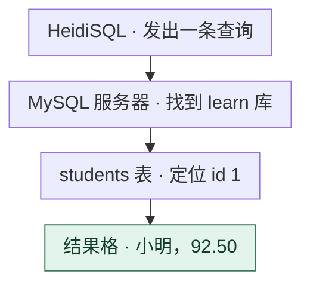

# 第 00 章 · 学前准备学习概览

> 一条 SQL 在哪里执行，数据又保存在哪里？从查一条已知记录把这些位置认清。

## 这一章学什么

- 认识客户端、MySQL 服务器、数据库、表、行和列。
- 理解主键怎样定位记录，知道什么时候要选择数据库。
- 看懂第一次建库、建表、写入样本各负责哪一层。

## 有什么用

你想查小明的成绩。HeidiSQL 是输入 SQL、查看结果的工具。服务器接到查询后，在 `learn` 库里的 `students` 表找 `id=1`，再返回指定列。以后报连接错误、找不到表、查不到人时，也可以沿这条路径分层排查。

本章先能说清「谁发命令、谁管数据、在找哪一行」。下一章再把查找条件写成完整的 `SELECT`。

## 从哪里开始

1. [数据库是什么](01_数据库是什么.md)，判断什么数据值得交给数据库，并认识表与主键。
2. [学习逻辑总图](02_学习逻辑总图.md)，跟一条查询走完整个请求和返回过程。

**学完自检** 能把「查小明分数」说成 `服务器 → learn → students → id=1 → score`，并在 HeidiSQL 找到结果格。

[全课程学习逻辑图](../学习逻辑图.md) · [教材首页](../README_怎么用.md)
