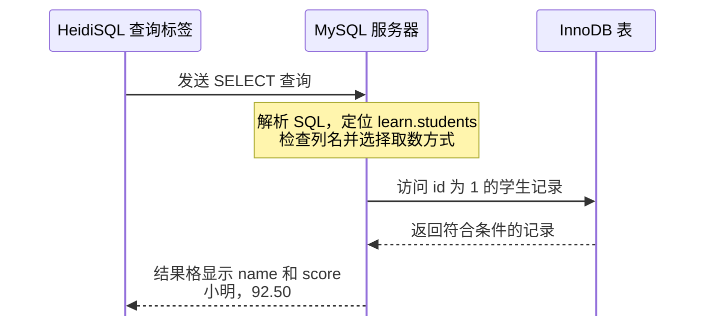

# 第 00 章 · 学习逻辑总图

> 先找对连接，再找对库和表。知道 SQL 正在哪一层工作，排查出错时就有顺序。

## 学习目标

- 区分客户端、服务器、库、表、行和列。
- 用完整名称和当前库两种方式指向同一张表。
- 看懂查询、增删改和结构操作分别影响哪个层级。

## 准备

使用本机的 HeidiSQL 连接和 `learn.students`。本篇只执行读操作。

## 一、一条 SQL 去了哪里

跟着下一节的第一条查表语句走一次。你运行了 `USE learn;`，然后执行 `SELECT name, score FROM students WHERE id = 1;`。图里向右是请求，向左是返回，按从上到下的顺序读。



HeidiSQL 通过连接把语句发到 `127.0.0.1:3306`。服务器根据这条连接选中的 `learn` 定位表，由 InnoDB（管理表和记录的存储引擎）提供数据。最后 MySQL 只返回你请求的两列，HeidiSQL 把它们显示在结果区。Python 用驱动发 SQL 时，也在图里客户端的位置。

## 二、两种方式写同一个地址

先选中库，再查表。也可以在表名前同时写库名。下面两个结果相同。

```sql
USE learn;
SELECT DATABASE() AS current_db;
SELECT name, score FROM students WHERE id = 1;
SELECT name, score FROM learn.students WHERE id = 1;
```

当前库应是 `learn`，两次查询都显示「小明，92.50」。`USE` 切换的是当前连接默认库。新连接的默认库可能不同。遇到 `1046 No database selected`，先执行 `USE learn` 或写成 `learn.students`。`1146` 则检查库名、表名及当前使用的环境。

## 三、操作的对象在哪一层

| 语句 | 作用在什么对象上 | 改动 |
|---|---|---|
| `SELECT` | 表中的行、列 | 读取结果 |
| `CREATE TABLE` | 库中的表 | 新增表结构 |
| `ALTER TABLE` | 已有表 | 可以改变列定义等结构 |
| `INSERT` | 表里的行 | 加行 |
| `UPDATE` | 表里的行及列 | 改值 |
| `DELETE` | 表里的行 | 删行 |
| `DROP TABLE` | 整张表 | 移除表及其已有数据 |

还没有学写入时，先能说清操作对象即可。后面会在独立演示表内练这些操作。

## 小结

问题如果是「找小明的分数」，可以先写出完整地址 `127.0.0.1:3306 → learn → students → id=1 → score`。换连接先核对前两层，换查询先核对表与条件。

## 动手练习

### 练习 1 · 去掉默认库依赖

不用 `USE`，只写一条语句取小红的姓名和分数。

<details>
<summary>展开参考答案</summary>

```sql
SELECT name, score FROM learn.students WHERE id = 2;
```

预期「小红，88.00」。

</details>

### 练习 2 · Python 和 HeidiSQL 在哪里

如果你从 Python 发送同一条 SQL，哪些层变了？

<details>
<summary>展开参考答案</summary>

客户端从 HeidiSQL 换成 Python 及驱动。只要连接地址、库、表和语句一致，服务器与目标数据仍是同一份。

</details>

### 练习 3 · 识别范围

想只移除一条记录、想移除整个表，要分别认识哪个命令？

<details>
<summary>展开参考答案</summary>

前者是带明确条件的 `DELETE`，后者是 `DROP TABLE`。写入和结构修改的具体练习分别在第 04、03 章。

</details>

**下一章** [第 01 章 · 查询基础学习概览](../01_查询基础/00_学习概览.md)
