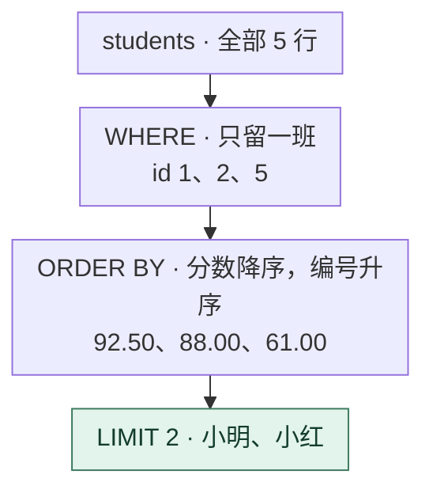

# 第 01 章 · 查询基础学习概览

> 把「一班成绩最高的两个人」说成几步可验证的查询，先确定行，再决定显示哪些列和顺序。

## 这一章学什么

- 连接 MySQL，使用 `SELECT` 选列、起别名、写计算列和去重。
- 用 `WHERE` 分清条件、括号、边界与空值。
- 用 `ORDER BY`、`LIMIT` 和 `OFFSET` 做可重复核对的排序与分页。

## 有什么用

要从成绩册取一班的前两名，先圈定一班，其次排分数，最后取两条。分数相同时按主键继续排，结果才有明确的先后。以教材里的五条学生记录为例。

同样的步骤可以用来查最近订单、找符合多个条件的记录。看计划图时按业务逐步手算，最后去结果格核对哪些编号留下。

## 从哪里开始

1. [连上 MySQL](01_连上MySQL.md)，确认服务器、账号与当前数据库。
2. [第一条 SELECT](02_第一条SELECT.md)，控制结果格里显示什么。
3. [SELECT 与 WHERE](03_SELECT与WHERE.md)，用条件决定哪些行保留。
4. [排序与限制](04_排序与限制.md)，取前几条、处理同分并翻页。

**学完自检** 给出两条条件，能在执行前预测保留哪些编号，并解释相同分数的两行谁在前。

[全课程学习逻辑图](../学习逻辑图.md) · [教材首页](../README_怎么用.md)
