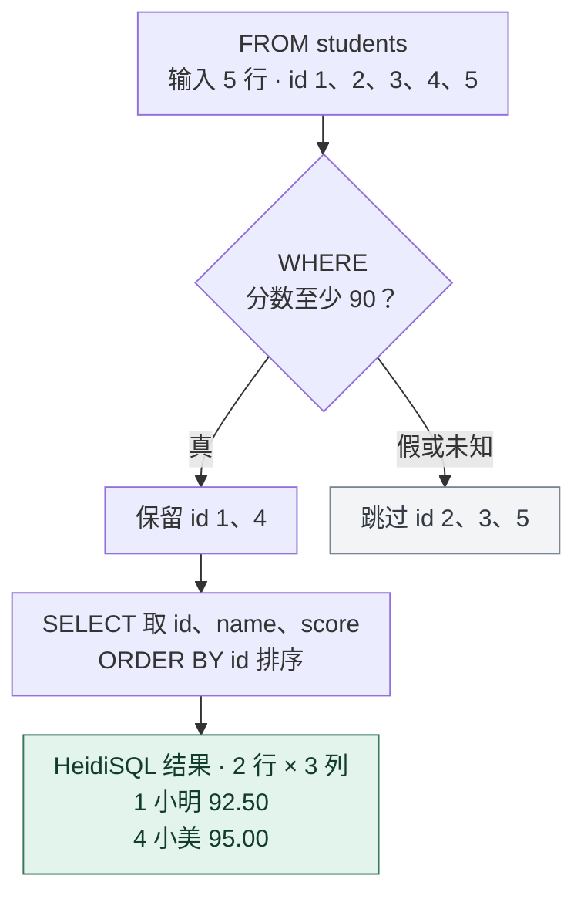

# 第 01 章 · WHERE 条件筛选

> 把需求改写成「对这一行提问」。只有条件结果为真的行会留下。

## 学习目标

- 使用比较、`AND` / `OR` / `NOT`、`IN`、`BETWEEN` 和 `LIKE` 写条件。
- 找出括号和 `NULL` 导致的结果差异。
- 从返回的主键检查条件有没有误选或漏选。

## 准备

```sql
USE learn;
SELECT id, name, age, class, score FROM students ORDER BY id;
```

使用本机 5 行学生样本。`id` 依次是 1 小明、2 小红、3 小刚、4 小美、5 小强。

## 一、比较是对每一行发问

```sql
SELECT id, name, score FROM students WHERE score >= 90 ORDER BY id;
```

这条查询可以按下面的路径手算。先用分数判断哪几行留下，再决定结果显示哪些列。



如果只从 `SELECT` 列表去掉 `score`，结果会变成 2 行 × 2 列。筛选还用原来的分数条件，留下的仍是 1 和 4。

`=`、`<>`（MySQL 也接受 `!=`）、`>`、`>=`、`<`、`<=` 分别表示相等、不等、大于、大于等于、小于、小于等于。把「至少 90」误写成 `> 90`，恰好 90 就会被排除。文本写单引号，例如 `class = '一班'`，数字条件直接写数字。

查询可按 `FROM → WHERE → SELECT` 理解。MySQL 在 `WHERE` 中不能引用本条 `SELECT` 的输出别名。下面第一条应报错，第二条把表达式直接放进条件。

```sql
-- 预期错误 1054
SELECT name, score + 5 AS adjusted FROM students WHERE adjusted > 95;
```

```sql
SELECT name, score + 5 AS adjusted FROM students WHERE score + 5 > 95 ORDER BY id;
```

## 二、括号决定哪几行通过

查「一班或二班，并且至少 90 分」。两条写法乍看类似，先预测编号。

```sql
SELECT id, name FROM students
WHERE class = '一班' OR class = '二班' AND score >= 90
ORDER BY id;

SELECT id, name FROM students
WHERE (class = '一班' OR class = '二班') AND score >= 90
ORDER BY id;
```

第一条是 1、2、4、5，因为 `AND` 先结算，所有一班学生都入选。第二条是 1、4。写需求时可把「必须」理解为外层 `AND`，把几个可选项用括号包成一组。`NOT` 取反。例如 `NOT (age < 18)` 对已有年龄值的学生等价于 `age >= 18`，遇到未知值时还要看第 4 节。

## 三、列表、范围、文本模式

```sql
SELECT id FROM students WHERE age IN (17, 19) ORDER BY id;
SELECT id FROM students WHERE score BETWEEN 80 AND 95 ORDER BY id;
SELECT id, name FROM students WHERE name LIKE '小%' ORDER BY id;
SELECT id, name FROM students WHERE name LIKE '_明' ORDER BY id;
```

依次得到 `2, 3, 5`、`1, 2, 4`、全部 5 人、只得到小明。`IN` 匹配列表的一项。`BETWEEN 80 AND 95` 包含两个端点。`LIKE` 用 `%` 匹配零个或多个字符，用 `_` 匹配一个字符。拿日期做范围也可以，但带时分秒的列若要覆盖完整最后一天，通常写「小于次日零点」。

## 四、NULL 表示条件可能未知

当前学生表的成绩未缺失。以下是常量查询，直接模拟缺失值，全程不用写表。

```sql
SELECT NULL = NULL AS ordinary_comparison,
       NULL IS NULL AS is_missing,
       NULL IS NOT NULL AS is_supplied,
       NULL + 5 AS still_missing,
       1 NOT IN (2, NULL) AS unknown_filter,
       2 NOT IN (2, NULL) AS known_false;
```

预期一行数据 `NULL, 1, 0, NULL, NULL, 0`。`= NULL` 和 `<> NULL` 都得不到真，判断缺失要用 `IS NULL`。`WHERE` 只保留真；假和未知都会被滤掉。例子里「1 不是 2」已知，但它是否等于列表里的未知项无法判断，整个 `NOT IN` 结果是未知。2 明确在列表中，所以 `NOT IN` 是假。需要明确排除一组已知值时，列表保持为已知值。

## 小结

先写出每行要满足的业务话，再翻译括号、边界和空值。预先写下会入选的两三条编号，执行后检查它们是否都按预期出现。

## 动手练习

### 练习 1 · 严格大于

找二班成绩严格高于 90 的学生。

<details>
<summary>展开参考答案</summary>

```sql
SELECT id, name, score FROM students WHERE class = '二班' AND score > 90 ORDER BY id;
```

只有 4，小美。

</details>

### 练习 2 · 名字与年龄

找名字以小开头、年龄为 17 或 19 的学生。分别用 `IN` 和带括号的 `OR` 写。

<details>
<summary>展开参考答案</summary>

```sql
SELECT id FROM students WHERE name LIKE '小%' AND age IN (17, 19) ORDER BY id;
SELECT id FROM students WHERE name LIKE '小%' AND (age = 17 OR age = 19) ORDER BY id;
```

两条均返回 2、3、5。

</details>

### 练习 3 · 看边界

筛选 88 至 92.50 分的学生，两个端点都要。

<details>
<summary>展开参考答案</summary>

```sql
SELECT id, score FROM students WHERE score BETWEEN 88 AND 92.50 ORDER BY id;
```

返回 1、2，两个端点都入选。

</details>

### 练习 4 · 缺失值判断

把找未填成绩的条件写成 `WHERE score = NULL` 会怎样？给出正确查询。

<details>
<summary>展开参考答案</summary>

```sql
SELECT id, name FROM students WHERE score IS NULL ORDER BY id;
```

`= NULL` 得到未知。当前样本没有缺失分数，因此正确查询也返回零行。用正文的常量例子能在不用改变表的情况下分辨二者。

</details>

**下一篇**：[排序与限制](04_排序与限制.md)
