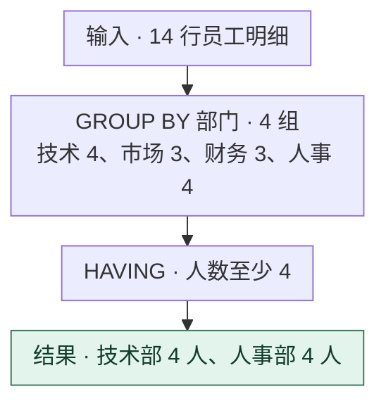

# 第 02 章 · 聚合分组学习概览

> 把员工名单变成部门统计表，决定一行代表一个人还是一个部门。

## 这一章学什么

- 用 `COUNT`、`SUM`、`AVG`、`MIN`、`MAX` 将许多行总结成指标。
- 用 `GROUP BY` 划组，并明确 `COUNT(*)` 与 `COUNT(列)` 的口径。
- 用 `WHERE` 决定参与计算的明细，用 `HAVING` 筛选计算后的组。

## 有什么用

你想知道哪些部门至少有 4 人。员工表含 14 位员工，算之前应该先把名单按部门分开，再对每组数人。如果问「至少有 4 人且平均工资超过门槛」，这两个要求都要在分组结果上判断。

奖金有空值时，已登记人员的平均与按所有员工分摊的数字可能不同。写出报表前先说明范围、分子和分母。

## 从哪里开始

1. [聚合函数](01_聚合函数.md)，从多行算出计数、总额或均值。
2. [GROUP BY 分组](02_GROUP_BY分组.md)，把一行的统计单位明确为一组。
3. [HAVING 过滤分组](03_HAVING过滤分组.md)，观察先筛行和先分组时计算结果怎样改变。
4. [综合练习](04_综合练习.md)，用同一份数据校验人数和金额口径。

**学完自检** 能说清「只看 2020 年及以前入职的人」和「平均工资至少 13,000 的部门」分别写在哪个子句。

[全课程学习逻辑图](../学习逻辑图.md) · [教材首页](../README_怎么用.md)
