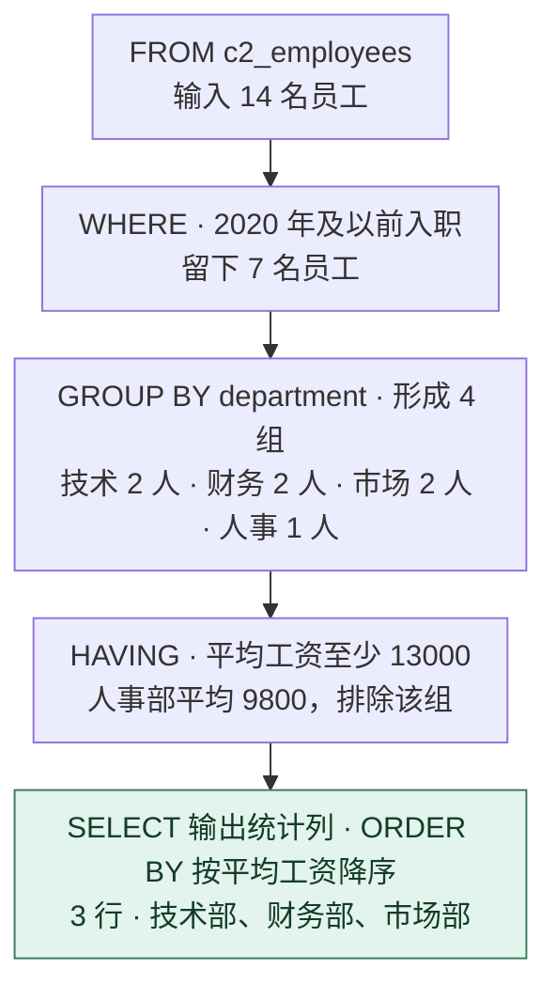

# 第 02 章 · HAVING 过滤分组

> 你想排除一名员工，还是想排除一个统计组？回答这个问题就能选对位置。

## 学习目标

- 把行条件放在 `WHERE`，把统计值条件放在 `HAVING`。
- 解释换掉筛选位置为何会改变平均值、人数或组数。
- 识别「每组取前 N」是按组挑明细，`HAVING` 单独无法完成。

## 准备

```sql
USE learn;
SELECT COUNT(*) AS starting_rows FROM c2_employees;
```

同一份 14 行员工表。技术部和人事部各 4 人，市场部和财务部各 3 人。

## 一、把「至少四人」放在组已经存在的位置

```sql
SELECT department, COUNT(*) AS employees
FROM c2_employees
GROUP BY department
HAVING COUNT(*) >= 4
ORDER BY MIN(id);
```

保留技术部、人事部，各 4 人。这条语句问「每一个部门的人数够不够」，先有部门统计，才能判断够不够。写成 `WHERE COUNT(*) >= 4` 会报 `1111`。

可以用 `FROM → WHERE → GROUP BY → HAVING → 输出 → ORDER BY → LIMIT` 想结果如何形成。数据库优化器可以改写执行步骤，逻辑含义保持一致。MySQL 支持 `HAVING employees >= 4` 直接引用本条 `SELECT` 的输出别名，即使别名在写出的代码里出现在 `SELECT` 子句；`WHERE` 不能这样做。

## 二、先筛员工和先筛组会回答不同问题

即使都用了 12,000 元，也先看条件在问员工的原始工资，还是整个部门的平均。

```sql
SELECT department, COUNT(*) AS employees, ROUND(AVG(salary), 2) AS average_salary
FROM c2_employees
WHERE salary >= 12000
GROUP BY department
ORDER BY MIN(id);

SELECT department, COUNT(*) AS employees, ROUND(AVG(salary), 2) AS average_salary
FROM c2_employees
GROUP BY department
HAVING AVG(salary) >= 12000
ORDER BY MIN(id);
```

第一条先拿掉工资低的成员。它统计技术（4 人，20250.00）、市场（2 人，13000.00）、财务（1 人，16000.00）。第二条算各部门全员工资均值后，只留下技术部（4 人，20250.00）。把门槛从 `WHERE` 挪到 `HAVING` 就换了业务口径。

## 三、需要先筛一次行、再筛一次组

需求是「只看 2020 年及以前入职员工；在这些人中，找平均工资不少于 13,000 的部门」。先圈日期，再圈平均工资。

```sql
SELECT department, COUNT(*) AS employees, ROUND(AVG(salary), 2) AS average_salary
FROM c2_employees
WHERE hire_year <= 2020
GROUP BY department
HAVING AVG(salary) >= 13000
ORDER BY AVG(salary) DESC, department;
```

把每一步当作一个检查点。到 `GROUP BY` 时，计数单位从「员工行」变成「部门组」。



| department | employees | average_salary |
|---|---:|---:|
| 技术部 | 2 | 24000.00 |
| 财务部 | 2 | 13500.00 |
| 市场部 | 2 | 13000.00 |

市场部的平均工资恰好在门槛上。预测一下，把 `>=` 改成 `>` 后，图里哪一步的行数会先变？前三步不变，`HAVING` 开始只留下两组。

如果连一个部门都没有入选，先运行只有 `WHERE` 的明细查询，再运行不带 `HAVING` 的分组查询，就能找到行数在哪一步变成了零。拿某组里仍有多个可能值的 `city` 来当组条件，会出现歧义。若想先保留某城市员工，写 `WHERE city = '北京'`。

`HAVING` 也可以在不显式 `GROUP BY` 的聚合查询里检查整个结果组。

```sql
SELECT COUNT(*) AS employees, ROUND(AVG(salary), 2) AS average_salary
FROM c2_employees
HAVING AVG(salary) >= 15000;
```

全公司平均约 13157.14，返回零行。

## 四、识别每组前几名的另一个任务

「保留平均工资最高的两个部门」可以在分组结果上排序后取两行。「每个部门各找工资最高的两个人」要保留员工明细，每组各自排，遇到并列还要规定怎么算。`HAVING` 适合判断整组留不留，`LIMIT` 限制的是整个结果。先把这两种任务区分好，第 05、10 章再实现第二种。

## 小结

把需求拆成「谁参与」和「哪个组留下」。前者先筛明细，后者筛统计值。输出之前核对每个数实际用了哪些成员。

## 动手练习

### 练习 1 · 至少三人且平均工资过线

保留人数至少 3 且平均工资超过 11000 的部门。

<details>
<summary>展开参考答案</summary>

```sql
SELECT department, COUNT(*) AS employees, ROUND(AVG(salary), 2) AS average_salary
FROM c2_employees GROUP BY department
HAVING COUNT(*) >= 3 AND AVG(salary) > 11000
ORDER BY AVG(salary) DESC, department;
```

结果依次为技术部、财务部、市场部。

</details>

### 练习 2 · 入职界线

只统计 2020 年以后入职的员工，保留至少两人的部门。2020 年入职的人不纳入。

<details>
<summary>展开参考答案</summary>

```sql
SELECT department, COUNT(*) AS employees FROM c2_employees
WHERE hire_year > 2020 GROUP BY department HAVING COUNT(*) >= 2
ORDER BY employees DESC, MIN(id);
```

人事部 3 人、技术部 2 人。财务部和市场部各 1 人，被组条件过滤。

</details>

### 练习 3 · 判断 LIMIT 的范围

每个部门各取两个人和全体取两个人，能不能用同一句 `LIMIT 2`？

<details>
<summary>展开参考答案</summary>

`LIMIT 2` 最多返回整条查询的两行。每部门各取两个人需要在明细层按组比较或排序，并明确是否保留并列。

</details>

**下一篇**：[聚合分组综合练习](04_综合练习.md)
