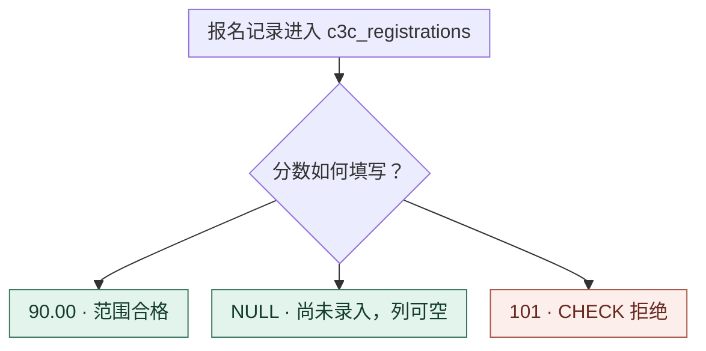

# 第 03 章 · 建表与约束学习概览

> 把业务规则写进结构，让数据库在录入错误时当场拒绝。

## 这一章学什么

- 使用 `CREATE TABLE`、`DESCRIBE` 和 `ALTER TABLE` 定义、查验和修改结构。
- 为文本、金额、日期等选类型，并判断哪些值允许缺失。
- 用 `PRIMARY KEY`、`UNIQUE`、`CHECK`、`FOREIGN KEY` 保护身份、范围和表关系。

## 有什么用

设计报名表时，报名号应唯一、姓名必填，分数可暂缺。若给出分数，它就应该在 0～100 之间。先定可接受的输入，再找一条边界样本和一条坏样本来验收。

类型决定值能否表达，约束决定它是否符合规则。跨表时也同样能检查，例如员工的部门编号必须指向真实存在的部门。

## 从哪里开始

1. [CREATE TABLE 入门](01_CREATE_TABLE入门.md)，建空表并用结构命令验收。
2. [数据类型](02_数据类型.md)，理解数值精度、时间和空值。
3. [约束](03_约束.md)，用正反样本核验主键、唯一、默认和取值范围。
4. [外键与表关系](04_外键与表关系.md)，追踪父记录变动如何影响子记录。
5. [综合练习](05_综合练习.md)，把业务描述转成能通过边界测试的表。

**学完自检** 能解释同一张表为何允许暂缺分数却拒绝 101 分，并能查到负责拒绝的那条检查约束。

[全课程学习逻辑图](../学习逻辑图.md) · [教材首页](../README_怎么用.md)
