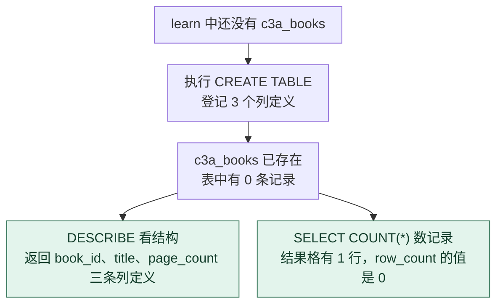

# 第 03 章 · CREATE TABLE 入门

> 你要先决定表里有哪些列、每列装什么，MySQL 才知道以后该怎么接收和检查数据。

## 学习目标

- 从一份图书登记需求里找出列名和类型，建出一张空表。
- 分辨「表不存在」和「表存在但没有行」，用两种命令检查结构。
- 给表加列、改列、删列、改名，并用结构查询验证每次修改。

## 准备

在 HeidiSQL 打开查询标签，按下面的顺序逐个运行代码块。把当前代码块粘到空白编辑区再按 **F9**，或只选中当前代码块按 **Ctrl+F9**。每次看完结果，再替换成下一段。

```sql
USE learn;
SELECT DATABASE() AS current_database;
SHOW TABLES LIKE 'c3a%';
```

当前库应是 `learn`。本篇的演示表由你亲手建出来，刚开始应该没有 `c3a_books` 和 `c3a_book_catalog`。若你做过本篇，先检查这些表，确认可以清空再用「删表和重做」小节里的命令。其余篇的配套表入口在 [第 03 章安装脚本](00_安装配套表.sql)。

## 一、从需求写出表头

图书登记要记录编号、书名和页数。把它想成一张还没写字的登记表。先给每个栏取名字，再决定它接收哪种值。

| 业务信息 | 列名 | 这次用的类型或规则 |
|---|---|---|
| 图书编号 | `book_id` | `INT` 整数 |
| 书名 | `title` | `VARCHAR(80)` 文本，上限 80 字符，`NOT NULL` 拒绝 SQL 的空值 |
| 页数 | `page_count` | `INT` 整数 |

```sql
CREATE TABLE c3a_books (
    book_id INT,
    title VARCHAR(80) NOT NULL,
    page_count INT
);
```

一列的基本顺序是「列名 → 数据类型 → 可选属性或约束」。列定义之间加逗号，最后一列后直接关括号。`AS` 起的查询别名只活在查询结果里，这里的列名会保存进表结构。

```sql
SELECT COUNT(*) AS row_count FROM c3a_books;
```

结果是 `0`。查询能正常执行，说明表已经存在。用没建过的名字做同样查询，则会收到 `1146`。

> 💡 **重点** 表名和列名用小写英文与下划线。用 `book_id`、`page_count` 这样的业务名，避开 `order`、`select` 等关键字。`c3a_` 表示这张表属于本篇。

## 二、用两种方式检查结构

```sql
DESCRIBE c3a_books;
SHOW CREATE TABLE c3a_books;
```

先看 `DESCRIBE` 的 `Field`、`Type` 和 `Null`。刚才声明的三列应依次出现，只有 `title` 的 `Null` 为 `NO`。`DESCRIBE` 像快速查看栏目和填写规则。`SHOW CREATE TABLE` 则像调出图纸，会列出索引、约束、存储引擎、字符集等信息。服务器会补上默认属性，输出的排版也可能与原输入不同。

如果只想知道「库里有没有这张表」，用 `SHOW TABLES`。如果想知道「`title` 最大有多长」，用 `DESCRIBE`。如果想复制结构或排查完整约束，看 `SHOW CREATE TABLE`。

建表成功以后，MySQL 已经保存了表结构，记录仍是空的。两条查验语句看到的是同一张表的两个方面。



看到结果格里的 `0`，就知道查询找到了这张表，并且表里目前没有记录。

## 三、修改已有的表

练习要求变化了，现在要记录出版社。加列像给登记表增加一个新栏，库里原来那些列会继续存在。

```sql
ALTER TABLE c3a_books ADD COLUMN publisher VARCHAR(60);
DESCRIBE c3a_books;
```

观察 `publisher` 出现在表尾。若原来已有行，这个可空列会得到 `NULL`。接下来把书名上限从 80 扩到 120，并继续保留原来的必填规则。

```sql
ALTER TABLE c3a_books MODIFY COLUMN title VARCHAR(120) NOT NULL;
DESCRIBE c3a_books;
```

> ⚠️ **注意** `MODIFY COLUMN` 要写出列需要保留的属性。这里如果漏了 `NOT NULL`，就会放宽必填规则。改真实数据表时，缩短列或改类型前先查已有值能否转换，并准备备份。

再去掉出版社列，把表改名为 `c3a_book_catalog`。`DROP COLUMN` 会一并删掉该列的数据。`RENAME TO` 改的是表名，原表名随即失效。

```sql
ALTER TABLE c3a_books DROP COLUMN publisher;
ALTER TABLE c3a_books RENAME TO c3a_book_catalog;
DESCRIBE c3a_book_catalog;
```

预期依次看到 `book_id`、`title`、`page_count`，书名仍是 `VARCHAR(120) NOT NULL`。

## 四、已经存在怎么办

重新运行下面这一句会报 `1050`。请只选中这一句执行，先确认错误码，再继续。

```sql
-- 预期错误 1050
CREATE TABLE c3a_book_catalog (book_id INT);
```

```sql
CREATE TABLE IF NOT EXISTS c3a_book_catalog (book_id INT);
SHOW WARNINGS;
DESCRIBE c3a_book_catalog;
```

`IF NOT EXISTS` 让同名表已存在时跳过创建。`SHOW WARNINGS` 可看到级别为 `Note` 的 `1050`。最后仍然是三列。要改变现有结构，回到 `ALTER TABLE`。

下面两段用来认出两种不同故障。第一段表名已被改掉，第二段漏了列定义之间的逗号。分别单独执行。

```sql
-- 预期错误 1146
DESCRIBE c3a_books;
```

```sql
-- 预期错误 1064
CREATE TABLE c3a_bad_syntax (book_id INT title VARCHAR(80));
```

## 五、删表和重做

删表会拿走整份登记表，包含表头和已有记录。下面只清理本篇亲手建的演示表。要保留成果，可以读完命令并跳过执行。

```sql
DROP TABLE c3a_book_catalog;
DROP TABLE IF EXISTS c3a_books;
DROP TABLE IF EXISTS c3a_book_catalog;
SHOW TABLES LIKE 'c3a%';
```

此时两张演示表都不存在。`DROP TABLE IF EXISTS` 让「目标本来就不在」也能继续，便于清理不同进度留下的演示表。在 MySQL 中，普通表的建、改、删会产生隐式提交。后面学到的 `ROLLBACK` 无法撤销这些普通表结构操作。

## 小结

建表先写列名与类型，需要的规则跟在类型后面。修改前先检查结构，修改后再查一次。做到这两次检查，你就能区分「SQL 能执行」和「结构符合要求」。

## 动手练习

### 练习 1 · 建空表

建 `c3a_notebooks`，列为 `notebook_id INT`、`title VARCHAR(40) NOT NULL`。分别确认有几列、几行。

<details>
<summary>展开参考答案</summary>

```sql
CREATE TABLE c3a_notebooks (notebook_id INT, title VARCHAR(40) NOT NULL);
DESCRIBE c3a_notebooks;
SELECT COUNT(*) AS row_count FROM c3a_notebooks;
```

两列，零行。第二题接着用这张表。

</details>

### 练习 2 · 改表并验收

给 `c3a_notebooks` 加 `owner_name VARCHAR(30)`，把书名上限扩到 60，保留必填，最后把表改名为 `c3a_note_catalog`。

<details>
<summary>展开参考答案</summary>

```sql
ALTER TABLE c3a_notebooks ADD COLUMN owner_name VARCHAR(30);
ALTER TABLE c3a_notebooks MODIFY COLUMN title VARCHAR(60) NOT NULL;
ALTER TABLE c3a_notebooks RENAME TO c3a_note_catalog;
DESCRIBE c3a_note_catalog;
```

三列。`title` 的 `Type` 是 `varchar(60)`，`Null` 是 `NO`。重做前可清理这两张练习表名。

```sql
DROP TABLE IF EXISTS c3a_note_catalog;
DROP TABLE IF EXISTS c3a_notebooks;
```

</details>

### 练习 3 · 先预测

如果已有一张三列的表，用同名 `CREATE TABLE IF NOT EXISTS` 声明四列，执行后会有几列？

<details>
<summary>展开参考答案</summary>

仍然三列。`IF NOT EXISTS` 只决定是否创建表。要加第四列，用 `ALTER TABLE … ADD COLUMN`，再检查结构。

</details>

**下一篇**：[数据类型](02_数据类型.md)
