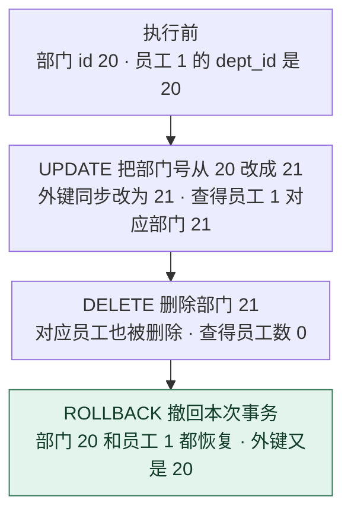

# 第 03 章 · 外键与表关系

> 员工档案写了「部门 20」时，外键让数据库能保证部门 20 确实存在。

## 学习目标

- 在一对多关系里找到外键应该放在哪一侧。
- 预测父记录删除或改键时，四种外键动作如何处理子记录。
- 建出一对一和多对多的结构，知道约束保证到了哪一步。

## 准备

在 `learn` 用 `c3d_departments` 和四张 `c3d_staff_…` 表。每张员工表初始只有一行，分别占用一个不同部门。部门 50 暂时没人引用。

```sql
USE learn;
SELECT id, dept_name FROM c3d_departments ORDER BY id;
SHOW CREATE TABLE c3d_staff_restrict;
SELECT @@session.foreign_key_checks AS checking_enabled;
```

预期有 5 个部门，`checking_enabled` 是 `1`。多条语句的示范按代码块整段执行。出现预期错误的块请单独执行，之后才继续。成功动作演示会回滚成原样。

## 一、外键的方向从子表指向父表

报名册上写的班级编号要能在班级名册里找得到。员工与部门也是同样的关系。部门信息有一份独立记录，员工只写自己的 `dept_id`。如果没有规则，数据库可以接受一个根本不存在的 `dept_id=999`。删除被引用的部门也可能留下悬空引用。

`SHOW CREATE TABLE` 里能看到本例的关系。下面是结构里的这部分。

```text
CONSTRAINT fk_c3d_restrict
    FOREIGN KEY (dept_id) REFERENCES c3d_departments (id)
    ON DELETE RESTRICT ON UPDATE RESTRICT
```

- 员工是子表，`dept_id` 是用于查找部门的外键列。
- 部门是父表，`id` 是其主键。设计时选择主键或合适的唯一键作为被引用目标。
- 两侧本例均为 `INT`，整数还要匹配有无符号属性。字符串外键要检查字符集和排序规则。父子表使用支持外键的同一引擎，本教程用 InnoDB。
- 多名员工可以填同一个部门编号，所以外键列通常不加 `UNIQUE`。

```sql
-- 预期错误 1452
INSERT INTO c3d_staff_restrict (id, name, dept_id) VALUES (99, '新员工', 999);
```

给新员工指定部门时，应先确保部门记录存在。如果业务允许暂未分配，可以允许 `dept_id` 为 `NULL`。`NULL` 表示缺少引用，`999` 是一个无效引用。

## 二、父表发生变化，子表怎么处理

| 子表 | 起始 dept_id | 父记录被删除或改主键 |
|---|---:|---|
| `c3d_staff_restrict` | 10 | `RESTRICT` 有引用便拒绝 |
| `c3d_staff_cascade` | 20 | `CASCADE` 删除对应子行，或同步改其外键 |
| `c3d_staff_nullable` | 30 | `SET NULL` 保留员工行，将外键设为 `NULL` |
| `c3d_staff_no_action` | 40 | `NO ACTION` 在 InnoDB 中与 `RESTRICT` 同效 |

`ON DELETE` 和 `ON UPDATE` 独立配置。后者是在父表**被引用的键值发生变化**时触发的。只改 `dept_name` 不会触发这些动作。在 InnoDB，省略动作默认 `NO ACTION`。它与 `RESTRICT` 都会立即拒绝违反规则的操作。

### RESTRICT 和 NO ACTION

想象你要撤掉一个部门。在仍有人归属这个部门时，规则要求你先调走员工。

```sql
-- 预期错误 1451
DELETE FROM c3d_departments WHERE id = 10;
```

```sql
-- 预期错误 1451
DELETE FROM c3d_departments WHERE id = 40;
```

再试没人引用的 50。它能删除，`ROW_COUNT()` 是 1。回滚后 50 再次出现。

```sql
START TRANSACTION;
DELETE FROM c3d_departments WHERE id = 50;
SELECT ROW_COUNT() AS deleted_departments;
ROLLBACK;
SELECT id FROM c3d_departments WHERE id = 50;
```

### CASCADE

先把 20 改成 21，再删掉 21。先预测子表每一步会发生什么，再运行。

```sql
START TRANSACTION;
UPDATE c3d_departments SET id = 21 WHERE id = 20;
SELECT id, dept_id FROM c3d_staff_cascade;
DELETE FROM c3d_departments WHERE id = 21;
SELECT COUNT(*) AS staff_left FROM c3d_staff_cascade;
ROLLBACK;
SELECT id, dept_id FROM c3d_staff_cascade;
```

图里只跟踪被本次操作命中的部门和员工。起点是初始数据，后面三格依次对应上面的三次查询。



三个查询依次看到 `(1, 21)`、`0`、`(1, 20)`。改变的是部门的主键与员工引用的部门号；员工自己的编号始终是 1。删除没有独立用途的草稿明细时，级联可能合适。员工档案需要留存时，应避免让删部门顺手删除员工。

### SET NULL

保留人，把归属留空。动作要求子表的外键列可空。下面分别验证「改父键」与「删父行」，前一个实验回滚后，后一段再次从部门 30 开始。

```sql
START TRANSACTION;
UPDATE c3d_departments SET id = 31 WHERE id = 30;
SELECT id, dept_id FROM c3d_staff_nullable;
ROLLBACK;

START TRANSACTION;
DELETE FROM c3d_departments WHERE id = 30;
SELECT id, dept_id FROM c3d_staff_nullable;
ROLLBACK;
```

两个查询均返回 `(1, NULL)`。如果系统要求员工始终归属某个部门，用可空列和 `SET NULL` 就会放开这条规则，应改成拒绝或经过明确的转移流程。

## 三、把关系画成可执行的表

| 业务规则 | 写法 | 能保证什么 |
|---|---|---|
| 部门可以有多名员工 | 员工表的 `dept_id` 加外键 | 所属部门存在，可以共用同一部门 |
| 部门最多有一条设置记录 | 设置表的 `dept_id` 加外键与 `UNIQUE` | 设置属于真实部门，同一个部门最多一条设置 |
| 部门可开多门课，课程也可给多个部门 | 用关联表保存部门与课程的编号，两个外键加组合主键 | 两端都存在，同一对部门与课程最多一行 |

下面的设置表用 `PRIMARY KEY (dept_id)` 同时实现唯一和非空，再加外键。一个部门可以暂时没有设置，也可以恰好有一条。父表的每条记录都必须有设置这项要求，需要额外的流程或设计。

```sql
CREATE TABLE c3d_department_settings (
    dept_id INT PRIMARY KEY,
    notify_email VARCHAR(100) NOT NULL,
    FOREIGN KEY (dept_id) REFERENCES c3d_departments (id)
) ENGINE=InnoDB DEFAULT CHARSET=utf8mb4;
SHOW CREATE TABLE c3d_department_settings;
DROP TABLE c3d_department_settings;
```

多对多像给两本名册做交叉登记。只要一张关联表，每行写一对编号。以后要存开课日期等属于这次关联的信息，可以考虑放在这张表。若同一个部门重复开同一门课是业务允许的，要把班次或开课批次计入新的唯一规则。

```sql
CREATE TABLE c3d_training_courses (
    id INT PRIMARY KEY,
    title VARCHAR(60) NOT NULL
) ENGINE=InnoDB DEFAULT CHARSET=utf8mb4;

CREATE TABLE c3d_department_courses (
    dept_id INT NOT NULL,
    course_id INT NOT NULL,
    PRIMARY KEY (dept_id, course_id),
    FOREIGN KEY (dept_id) REFERENCES c3d_departments (id),
    FOREIGN KEY (course_id) REFERENCES c3d_training_courses (id)
) ENGINE=InnoDB DEFAULT CHARSET=utf8mb4;

SHOW CREATE TABLE c3d_department_courses;
DROP TABLE c3d_department_courses;
DROP TABLE c3d_training_courses;
```

先建父表再建子表。拆除结构时反过来，先删自己的子表。即使子表没有记录，外键定义还在时也可能阻止删父表。始终保留外键检查。

## 四、选规则时评估写入和维护

外键会检查键值，在写入、级联、迁移数据时会增加索引访问、锁或顺序约束。它的好处是应用、导入脚本和手动写入都遵守同一套规则。许多单库业务适合这样守一致性。跨分片的数据没有同一个本地键可以校验，常需要应用协调、校验和修复流程。单库是否值得改成由应用维护，要看实际负载、迁移要求和故障后的补偿能力。

## 小结

先判断子记录缺了父记录还能不能独立存在，再选约束动作。能保留但可失去归属时考虑 `SET NULL`。必须随父记录一起变化且影响范围可控时考虑 `CASCADE`。规则尚未确定时，先用拒绝来保住现有关系。

## 动手练习

### 练习 1 · 能不能不填部门

在两张员工演示表里试插 `(77, '候选人', NULL)`。选 `c3d_staff_restrict` 和 `c3d_staff_nullable` 各试一次。

<details>
<summary>展开参考答案</summary>

```sql
-- 预期错误 1048
INSERT INTO c3d_staff_restrict (id, name, dept_id) VALUES (77, '候选人', NULL);
```

```sql
START TRANSACTION;
INSERT INTO c3d_staff_nullable (id, name, dept_id) VALUES (77, '候选人', NULL);
SELECT id, dept_id FROM c3d_staff_nullable WHERE id = 77;
ROLLBACK;
```

第一条违反非空规则。第二张表允许缺少引用，返回 `(77, NULL)`。

</details>

### 练习 2 · 部门换号

把部门 10 的主键改成 11 会发生什么？如果只把技术部改名呢？

<details>
<summary>展开参考答案</summary>

```sql
-- 预期错误 1451
UPDATE c3d_departments SET id = 11 WHERE id = 10;
```

```sql
START TRANSACTION;
UPDATE c3d_departments SET dept_name = '工程部' WHERE id = 10;
SELECT dept_id FROM c3d_staff_restrict;
ROLLBACK;
```

改编号会被拒绝，部门改名可以成功，子表的 `dept_id` 仍是 10。

</details>

### 练习 3 · 员工和项目

一个项目有多名员工，同一员工可参加多个项目。你会在什么地方加外键，怎么防止同一个人被重复加入同一个项目？

<details>
<summary>展开参考答案</summary>

建项目成员表，用 `employee_id` 与 `project_id` 分别引用两个父表，并将两列共同定义为主键。若每次加入都保留历史，先明确允许重复加入的区分条件，例如加入批次。

</details>

可查 [MySQL 外键约束手册](https://dev.mysql.com/doc/refman/9.7/en/create-table-foreign-keys.html)。

**下一篇**：[建表与约束综合练习](05_综合练习.md)
