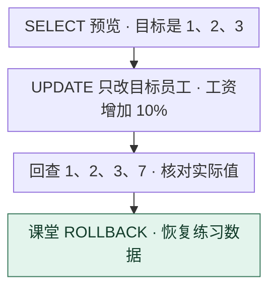

# 第 04 章 · 增删改学习概览

> 写入前先列出目标，写入后再确认库里究竟改了什么。

## 这一章学什么

- 用 `INSERT` 补一条或多条记录，判断自增、缺省值与重复键。
- 用精准的 `WHERE` 更新或删除指定行，区分物理删除和软删除。
- 练会预览、影响行数、复查、回滚与导出恢复。

## 有什么用

给技术部在职员工涨薪时，先圈出 1、2、3 号，离职的 7 号应保持原样。更新后查一次，1 号从 10,000 变为 11,000。演练用回滚把样本恢复。

相同的写入流程可以用来调薪、归档或清理过期记录。记录已提交时，恢复要靠可验证的备份。

## 从哪里开始

1. [INSERT 插入](01_INSERT插入.md)，新增一行或多行并处理默认值。
2. [UPDATE 修改](02_UPDATE修改.md)，按已确认的主键和值更新。
3. [DELETE 删除](03_DELETE删除.md)，掌握删除、截断和软删除的使用条件。
4. [安全操作习惯](04_安全操作习惯.md)，练预览、备份回放与撤回。
5. [综合练习](05_综合练习.md)，用单表场景完整复盘修改流程。

**学完自检** 看到一条 UPDATE，能先写出对应的 SELECT，说明会改哪些行，再用演练事务验证回滚。

[全课程学习逻辑图](../学习逻辑图.md) · [教材首页](../README_怎么用.md)
