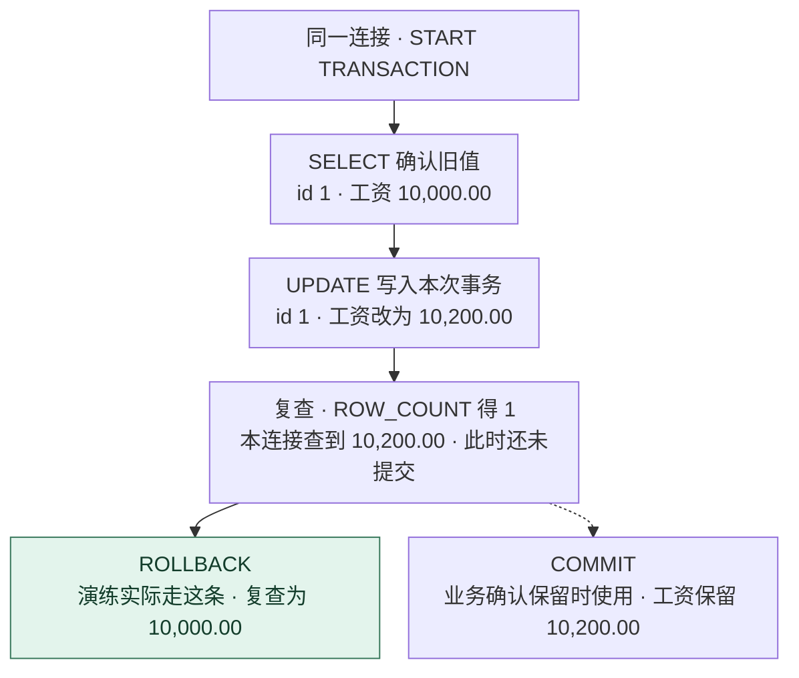

# 第 04 章 · 安全操作习惯

> 每次写入前回答三个问题。会动哪些行，怎么证明改对了，出了问题从哪里恢复？

## 学习目标

- 用同条件预览、行数检查、事务和复查组织一次写入。
- 导出独立数据文件，知道如何验收并谨慎回放。
- 区分安全更新、软删除与操作日志各自能解决的问题。

## 准备

本篇使用 `c4d_employees`（9 行）和 `c4d_operation_log`（初始空表）。下文每条写语句各自只写一个表。建议用新查询标签，先确认连接状态。

```sql
USE learn;
SELECT DATABASE() AS current_db,
       @@session.autocommit AS autocommit_enabled,
       @@session.sql_safe_updates AS safe_updates;
SELECT id, department, status, salary FROM c4d_employees ORDER BY id;
```

## 一、先圈出目标

只凭「技术部」三个字就改工资，容易连离职档案一起改。用 `SELECT` 验证你的业务条件，记下主键、旧值、行数，然后用确认过的主键收紧写入范围。

```sql
START TRANSACTION;
SELECT id, status, salary FROM c4d_employees
WHERE department = '技术部' AND status = 'active' ORDER BY id;

UPDATE c4d_employees
SET salary = salary * 1.10
WHERE id IN (1, 2, 3) AND department = '技术部' AND status = 'active';

SELECT ROW_COUNT() AS changed_rows;
SELECT id, salary FROM c4d_employees WHERE id IN (1, 2, 3, 7) ORDER BY id;
ROLLBACK;
```

预览得到 1、2、3，影响 3 行，新工资依次 11000、8800、6600。离职的 7 保持 11000。生产环境可能有其他连接同时改数据。普通预览不会锁住目标，得到的行集合和数值也可能在写入前变化。并发控制的完整做法留到第 08 章。

## 二、在同一连接里完成一次检查

上一节先确认目标。这一次再看清「已经改了」和「已经提交」之间的时间点。选中整块执行，比较修改前、修改后和回滚后查到的三个值。

```sql
START TRANSACTION;
SELECT id, salary FROM c4d_employees WHERE id = 1;
UPDATE c4d_employees SET salary = 10200.00 WHERE id = 1;
SELECT ROW_COUNT() AS changed_rows;
SELECT id, salary FROM c4d_employees WHERE id = 1;
ROLLBACK;
SELECT id, salary FROM c4d_employees WHERE id = 1;
```



图中实线是这段 SQL 的实际运行路径。业务操作结束时，按目标选择一次 `COMMIT` 或 `ROLLBACK`。普通 `CREATE TABLE`、`ALTER TABLE`、`TRUNCATE TABLE`、`DROP TABLE` 会隐式提交，应和这一组 DML 分开。可查 [MySQL InnoDB 事务手册](https://dev.mysql.com/doc/refman/26.10/en/innodb-autocommit-commit-rollback.html)。

## 三、写入前导出可恢复的数据

一份副本只有在能读、能定位、能恢复时才有价值。下面用本机 MySQL 的 `mysqldump`，把 5、7 号练习记录导出为每行一条带列名的 `INSERT`。PowerShell 用来执行系统命令，HeidiSQL 用来执行 SQL。

先在 HeidiSQL 对照源数据。

```sql
SELECT * FROM c4d_employees WHERE id IN (5, 7) ORDER BY id;
```

然后在可写的 PowerShell 目录运行，输入你现用的本机密码。脚本退出码为零后，再检查文件存在与大小。

```powershell
$mysqlDump = 'F:\Scoop\apps\mysql\current\bin\mysqldump.exe'
$backup = [IO.Path]::Combine((Get-Location).Path, ('c4d_employees_{0}.sql' -f (Get-Date -Format 'yyyyMMdd_HHmmssfff')))
& $mysqlDump --host=127.0.0.1 --port=3306 --user=root -p --default-character-set=utf8mb4 `
  --skip-opt --quick --single-transaction --no-tablespaces --set-gtid-purged=OFF `
  --skip-triggers --no-create-info --complete-insert '--where=id IN (5, 7)' `
  "--result-file=$backup" learn c4d_employees
if ($LASTEXITCODE -ne 0) { throw '导出失败，请先处理错误。' }
Get-Item -LiteralPath $backup | Select-Object Name,Length
```

> ⚠️ **注意** 打开 UTF-8 导出文件，与预览核对。应有两条 `INSERT INTO`，表名为 `c4d_employees`，主键是 5 和 7，列清单包含 `id` 到 `created_at`。命令只保存选中的行数据，恢复以原结构仍在为前提。

删除练习尚未提交时直接回滚。有已提交误删时，先在隔离环境验证结构、备份列和行，再检查当前表的主键和唯一工号没有冲突。只选中经检查的 `INSERT INTO` 数据语句，放入显式事务，逐步复查后决定提交。导出文件头尾还有会话设置，不要把原始文件整份执行到正在使用的查询连接。练习最后一题会用同样的办法在表里验证回放。

## 四、控制一次最多改多少

一条 `DELETE … LIMIT 1` 仍可能删错第一行。给它目标条件和明确顺序，先用同样的筛选和排序预览，再动手。

```sql
START TRANSACTION;
SELECT id FROM c4d_employees WHERE status = 'left' ORDER BY id LIMIT 1;
DELETE FROM c4d_employees WHERE status = 'left' ORDER BY id LIMIT 1;
SELECT ROW_COUNT() AS deleted;
SELECT id FROM c4d_employees WHERE status = 'left' ORDER BY id;
ROLLBACK;
```

本批目标是 5，检查剩余 6、7。批量业务还要有可追踪的断点和候选范围，循环执行之前先验证后续批次会落在哪些记录。

## 五、明确哪些记录应该留痕

离职档案需要历史时，可以用软删除隐藏。只有业务上允许丢失该记录，才使用物理删除。下面用主键定位 7，并要求记录原本没有归档。

```sql
START TRANSACTION;
UPDATE c4d_employees SET deleted_at = CURRENT_TIMESTAMP
WHERE id = 7 AND status = 'left' AND deleted_at IS NULL;
SELECT ROW_COUNT() AS archived;
SELECT id FROM c4d_employees WHERE status = 'left' AND deleted_at IS NULL ORDER BY id;
ROLLBACK;
```

影响 1 行，日常离职名单剩 5、6。报表是否包含软删行，要把条件写明白。软删除会继续占空间，也需要有明确的保留期限和清理策略。

## 六、把谁改了什么写进日志

单独存一份业务日志，可以留下操作者、目标、旧值、新值、原因和时间。下面先确认数据再执行一条更新，最后向日志写一条记录。两条写操作用同一个事务，可以一起提交或撤回。

```sql
START TRANSACTION;
SELECT id, salary FROM c4d_employees WHERE id = 1;
UPDATE c4d_employees SET salary = 10200.00 WHERE id = 1 AND salary = 10000.00;
SELECT ROW_COUNT() AS changed_rows;
```

确认影响行数为 1，再在**同一个查询标签**运行下一段。若当前工资或状态与基线不符，直接 `ROLLBACK;`，别写成功日志。

```sql
INSERT INTO c4d_operation_log
    (target_table, target_id, action_name, old_salary, new_salary, operator_name, reason)
VALUES ('c4d_employees', 1, 'adjust_salary', 10000.00, 10200.00, CURRENT_USER(), '课堂演示');
SELECT target_id, old_salary, new_salary, reason FROM c4d_operation_log
WHERE target_table = 'c4d_employees' AND target_id = 1 ORDER BY id;
ROLLBACK;
```

练习表为空时，日志查询得到一行：1、10000.00、10200.00、课堂演示。回滚后工资与日志都恢复。实际应用应记录真实的业务操作者和请求信息。共用数据库账号时，`CURRENT_USER()` 只反映当前认证账号。

## 七、打开客户端保护

MySQL 的 `sql_safe_updates` 是会话级护栏。下面故意漏掉条件，单独执行中间的错误块。安全更新模式通常要求用到键的条件或 `LIMIT`。即使写了 `WHERE`，如果优化器无法使用键，也可能拒绝。

```sql
SET @c4_old_safe_updates = @@session.sql_safe_updates;
SET SESSION sql_safe_updates = 1;
START TRANSACTION;
```

```sql
-- 预期错误 1175
UPDATE c4d_employees SET salary = 5000.00;
```

收到 `1175` 后，在同一个连接执行安全的写法，再收回练习并恢复原会话设置。

```sql
UPDATE c4d_employees SET salary = 5000.00 WHERE id = 1;
SELECT ROW_COUNT() AS changed_rows;
ROLLBACK;
SET SESSION sql_safe_updates = @c4_old_safe_updates;
```

命令行客户端也可以在连接时加 `mysql --safe-updates`。它是 `mysql` 客户端选项，同时设置查询结果和连接规模相关限制。即使通过保护，错误的主键、漏掉关键业务条件，也可能改错。保留保护，并继续核对目标。

## 八、用事故场景推演恢复

**场景 A**。清理脚本漏了离职条件，事务尚未结束。先停下写入，在同一连接回滚，复查表的目标行和总数。修好条件、预览、重新执行。

**场景 B**。清理任务已经提交，随后其他同事写入了新的记录。先暂停同一范围的后续写入，确定受影响的主键和提交时间。在隔离环境验证备份或恢复方案，再补回受损数据，最后核对现有新记录是否完整。用旧副本直接覆盖整张表会把误删后的合法写入也丢掉。

## 小结

一次写入有三个验收点。动手前确认目标，提交前确认结果，通常给重要数据准备经验证的恢复来源。写完看一眼受影响行数，还要核对结果里的具体编号和值。

## 动手练习

### 练习 1 · 列出目标再改

市场部在职员工工资加 100 元。写出预览条件及收紧后的更新条件，并列出应保留哪条市场部离职档案。

<details>
<summary>展开参考答案</summary>

```sql
START TRANSACTION;
SELECT id, salary FROM c4d_employees
WHERE department = '市场部' AND status = 'active' ORDER BY id;
UPDATE c4d_employees SET salary = salary + 100.00
WHERE id IN (4, 9) AND department = '市场部' AND status = 'active';
SELECT ROW_COUNT() AS changed_rows;
SELECT id, salary FROM c4d_employees WHERE id IN (4, 5, 9) ORDER BY id;
ROLLBACK;
```

4 变为 9100，9 变为 5100，离职的 5 保持 7000。

</details>

### 练习 2 · 安全模式能拦什么

打开安全更新后，`UPDATE c4d_employees SET salary = 0 WHERE id = 9` 是否一定会被拦？这说明了什么？

<details>
<summary>展开参考答案</summary>

按现有主键筛选通常能通过。数据库能检查命令有没有使用键，无法判断 9 号本来是否该改成 0。还要预览目标、核对旧值与业务规则。

</details>

### 练习 3 · 什么时候要找备份

你刚发现误删。如何分别处理「同一个连接还没提交」和「已提交」？

<details>
<summary>展开参考答案</summary>

还没提交，在原连接执行 `ROLLBACK`，再核对受影响的行。已经提交，确定主键范围、检查备份或历史记录、在隔离数据上验证并有选择地补回所需行。

</details>

可查 [MySQL 客户端 Safe Updates](https://dev.mysql.com/doc/refman/9.7/en/mysql-tips.html) 和 [mysqldump 选项](https://dev.mysql.com/doc/refman/9.7/en/mysqldump.html)。

**下一篇**：[增删改综合练习](05_综合练习.md)
