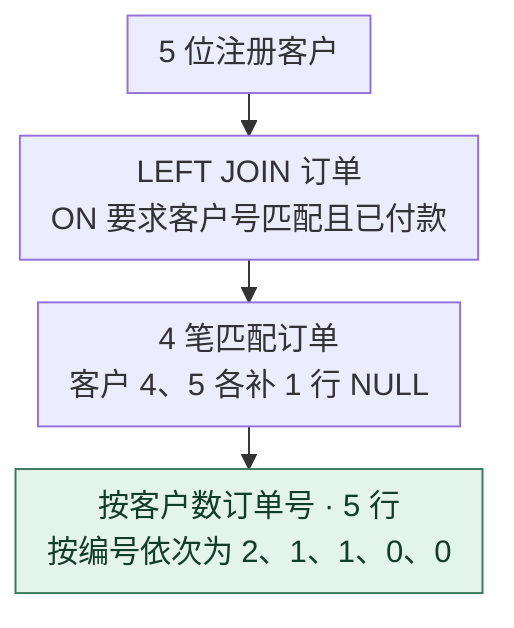

# 第 05 章 · 多表查询学习概览

> 把分开的客户、订单、明细和商品重新查成一份报表，保证统计单位清楚。

## 这一章学什么

- 用内连接和外连接决定保留哪些匹配，理解一对多为何产生多行。
- 用子查询表达门槛、集合、存在性和最新一条记录。
- 用 `UNION` 合并两份结果，选择是否去重。

## 有什么用

业务要求每位注册客户一行，显示已付款次数。客户 4 有取消订单，客户 5 从未下单，两个人都应以 0 次显示。先保留客户侧，把付款条件放进 `ON`，再数匹配到的订单号。

再连接商品明细时，一笔订单可以展开成多行。开始计算销售额或订单数之前，先确认一行是订单还是明细，并说明游客是否参与。

## 从哪里开始

1. [为什么要拆表](01_为什么要拆表.md)，认清不同业务对象的一行粒度。
2. [INNER JOIN](02_INNER_JOIN.md)，根据关联键找匹配行并预测数量。
3. [外连接与自连接](03_外连接与自连接.md)，保留零匹配记录，并区分 ON 与 WHERE。
4. [子查询](04_子查询.md)，按返回形状处理门槛、存在性与最新记录。
5. [UNION 与写入查询结果](05_UNION与写入查询结果.md)，合并清单并验证复制查询结果。
6. [综合练习](06_综合练习.md)，用游客、取消、空匹配和并列检验报表。

**学完自检** 能解释一条订单连接明细后为什么出现多行，以及什么时候必须按订单号去重计数。

[全课程学习逻辑图](../学习逻辑图.md) · [教材首页](../README_怎么用.md)
