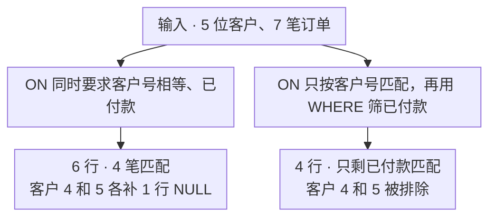

# 第 05 章 · 外连接与自连接

> 要看所有客户的付款情况，零单客户也该有一行。关键是你在哪一步用状态筛选。

## 学习目标

- 用 LEFT JOIN 保留无匹配记录，区分 ON 和 WHERE 的条件。
- 用非空主键判断有无匹配，并理解 RIGHT JOIN、全外连接模拟和自连接。

## 准备

在 HeidiSQL 选择 `learn`。缺少 `c5_` 表时，先运行[本章配套 SQL](00_安装配套表.sql)。本章使用 5 名客户、7 笔订单、11 条明细、6 种商品，以及一张 3 人的员工表。订单状态为 `paid` 已付款、`pending` 待付款、`cancelled` 已取消。订单 107 是游客已付款订单，`customer_id` 为 `NULL`。
```sql
USE learn;
```

## 一、哪些过滤条件能让零单客户出现

```sql
SELECT c.id AS customer_id, o.id AS paid_order_id
FROM c5_customers AS c
LEFT JOIN c5_orders AS o ON o.customer_id = c.id AND o.status = 'paid'
ORDER BY c.id, o.id;

SELECT c.id AS customer_id, o.id AS paid_order_id
FROM c5_customers AS c
LEFT JOIN c5_orders AS o ON o.customer_id = c.id
WHERE o.status = 'paid'
ORDER BY c.id, o.id;
```

第一条有 6 行，客户 1 配两单，2、3 各一单，4、5 各得一行 `NULL`。第二条只剩 4 行。客户 4 的取消订单已经匹配，后来被 `WHERE` 去掉；客户 5 的补空行也过不了 `o.status = 'paid'`。把一个会排除右表补空行的条件放到 `WHERE`，就失去了这里要保留的零匹配记录。



若只查「没有任何订单」的客户，将右表的必有值 `o.id` 用 `IS NULL` 检查。检查的是整条右记录有没有匹配。

```sql
SELECT c.id, c.name
FROM c5_customers AS c
LEFT JOIN c5_orders AS o ON o.customer_id = c.id
WHERE o.id IS NULL
ORDER BY c.id;
```

只返回客户 5。要找「没有已付款订单」，将付款条件加在 `ON`，同样检查 `o.id IS NULL`，会多出取消订单客户 4。分组时，补空行会被 `COUNT(*)` 计入；数匹配订单要用 `COUNT(o.id)`。

## 二、从右侧保留客户

`RIGHT JOIN` 保留右表。下方把客户放在右侧，和「客户放左侧的 LEFT JOIN」得到同一份匹配清单。

```sql
SELECT c.id AS customer_id, o.id AS order_id
FROM c5_orders AS o
RIGHT JOIN c5_customers AS c ON o.customer_id = c.id
ORDER BY c.id, o.id;
```

结果有 7 行，客户 5 的订单号为空，游客 107 无客户匹配，因此不会出现。要同时保留两边各自没配上的行，需要全外连接的语义，在 [UNION 与写入查询结果](05_UNION与写入查询结果.md) 中完成这个例子。

## 三、同一张名单可以扮演两种角色

```sql
SELECT e.id, e.name AS employee_name, m.name AS manager_name
FROM c5_staff AS e
LEFT JOIN c5_staff AS m ON m.id = e.manager_id
ORDER BY e.id;
```

3 行。钱晓和吴青的上司都是宋言；宋言的上司为空，其记录仍保留。想看「员工」和「经理」是两个角色，所以必须给这两个表引用起不同别名。

## 小结

保留范围写进连接类型，匹配资格写进 ON，需要排掉最终行时再用 WHERE。

## 动手练习

### 练习 1 · 区分取消和从未下单

找没有已付款订单的客户。确认是否包含陈禾。

<details>
<summary>展开参考答案</summary>

```sql
SELECT c.id, c.name
FROM c5_customers AS c
LEFT JOIN c5_orders AS o ON o.customer_id = c.id AND o.status = 'paid'
WHERE o.id IS NULL ORDER BY c.id;
```

4 陈禾、5 吴昕。陈禾有取消订单，付款条件让该订单没有匹配资格。

</details>

### 练习 2 · 数已付款订单

每位客户一行，给出已付款订单数。

<details>
<summary>展开参考答案</summary>

```sql
SELECT c.id, COUNT(o.id) AS paid_orders
FROM c5_customers AS c
LEFT JOIN c5_orders AS o ON o.customer_id = c.id AND o.status = 'paid'
GROUP BY c.id ORDER BY c.id;
```

按 1～5 依次是 2、1、1、0、0。游客不属于注册客户报表。

</details>

**下一篇** [子查询](04_子查询.md)
