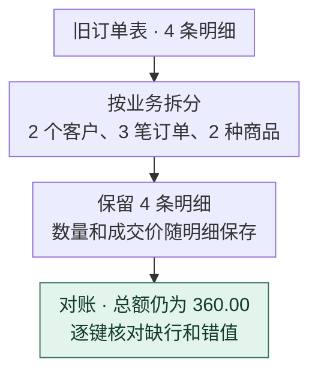

# 第 06 章 · 表设计学习概览

> 用「谁决定谁」处理重复字段，让拆表前后的每一笔金额都能对上。

## 这一章学什么

- 确定一行的含义和主键，按第一、第二、第三范式判断字段位置。
- 区分现有事实与历史快照，避免商品改价影响旧订单金额。
- 迁移前找冲突，迁移后按键逐行对账。

## 有什么用

旧订单表每条明细都重复存姓名和城市。一个客户搬家时，多处修改容易留下矛盾。将当前客户字段放在客户表，把成交价留在明细。迁移结束后用行数、金额、原键和新键一起核对。

这个过程能帮助你整理重复的 Excel 台账或旧系统导出。总额对上只能说明合计一致，逐键核对才能发现两条相反的错价互相抵消。

## 从哪里开始

1. [粒度、依赖与范式](01_粒度依赖与范式.md)，按业务依赖决定各字段属于哪张表。
2. [拆表迁移与对账](02_拆表迁移与对账.md)，先查冲突，再迁移并逐行验收。

**学完自检** 能指出哪一列由客户编号决定、哪一列应跟随订单明细，并写出迁移时要对照的主键与金额。

[全课程学习逻辑图](../学习逻辑图.md) · [教材首页](../README_怎么用.md)
