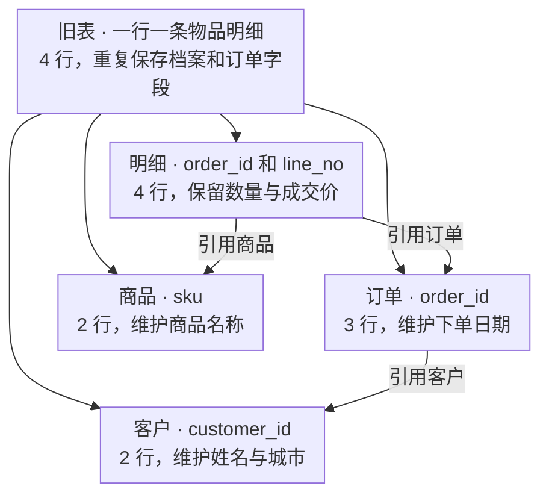

# 第 06 章 · 粒度、依赖与范式

> 遇到一张宽表，先写下「谁决定谁」，据此判断该把列放在哪一张表。

## 学习目标

- 判断明细、订单、客户和商品各自的一行粒度。
- 用同一份数据区分第一、第二和第三范式。
- 区分冗余的当前事实、事件快照和另存的汇总。

## 准备

缺表时运行[配套 SQL](00_安装配套表.sql)。`c6_legacy_sales` 模拟有 4 条明细的旧导出表。先用只读查询观察。
```sql
USE learn;
SELECT order_id, line_no, sold_on, customer_id, customer_name, city, sku, unit_price
FROM c6_legacy_sales ORDER BY order_id, line_no;
```

## 一、先说清业务规则，再用数据找反例

订单 201 出现两次，对应行号 1、2。四行里有三个订单、两个客户、两个商品。名称会变，也可能重名，关联时用稳定的 ID 或编号。以下规则来自本练习的业务约定，样本用来寻找反例。

| 给定什么就能确定 | 可以确定的列 |
|---|---|
| `order_id` | `sold_on`、`customer_id` |
| `customer_id` | 当前的 `customer_name`、`city` |
| `sku` | 当前的 `product_name` |
| `(order_id, line_no)` | `sku`、`quantity`、成交时的 `unit_price` |

一个编号对应两个互相冲突的城市时，说明这份数据违反了「一个客户只有一个当前城市」的规则。若业务要留收货城市，它的决定者可能是订单，两种城市要分别命名。

## 二、用这份订单走完三个范式

- **第一范式**。让每个字段存一个可单独处理的业务值。一单一行、把「键盘×1，鼠标×2」塞进一个字符串，会让按商品筛选与数量校验难做。拆成明细后，一行一条商品明细。
- **第二范式**。在这个组合键样本里，避免非键字段只依赖组合键的一部分。`sold_on` 只看 `order_id` 就能确定。把订单日期与客户号搬到订单表，一单一行。
- **第三范式**。再检查是否通过另一个非键列间接决定属性。订单号确定客户号，客户号确定当前城市。客户表存城市，订单表引用客户号。商品名称随商品档案维护，成交价留在明细。以上判断以这份数据的业务规则为准。



## 三、用一个价格样本检查你的判断

```sql
SELECT sku, COUNT(*) AS line_count,
       MIN(unit_price) AS low_price, MAX(unit_price) AS high_price
FROM c6_legacy_sales
GROUP BY sku ORDER BY sku;
```

键盘和鼠标各出现在两条明细，成交价格分别跨 100.00～105.00、50.00～55.00。成交价有时间含义，价格不同并不违反规则。为了加快某个报表，也可以额外维护汇总表，但要先约定它何时更新、由哪份数据重算、失配怎么发现。

## 小结

从主键和业务规则判断哪些字段该住在一起。当前事实有唯一维护位置，历史快照随对应事件保留。

## 动手练习

### 练习 1 · 把两个价格放到合适的位置

鼠标现价和订单 201 买鼠标时的价格各放哪儿？只保留现价会怎样？

<details>
<summary>展开参考答案</summary>

现价属于商品档案。成交时的 50.00 属于订单 201 的第 2 行明细。若旧订单只引用商品现价，今天的改价会改变昨天的成交额。

</details>

### 练习 2 · 用查询找日期冲突

验证样本中，同一订单是否出现多个日期。如何解释没有返回？

<details>
<summary>展开参考答案</summary>

```sql
SELECT order_id FROM c6_legacy_sales
GROUP BY order_id HAVING COUNT(DISTINCT sold_on) > 1
ORDER BY order_id;
```

返回 0 行，当前样本没发现冲突。真实业务仍要从规则和变更流程保证一单一日。

</details>

**下一篇** [拆表迁移与对账](02_拆表迁移与对账.md)
