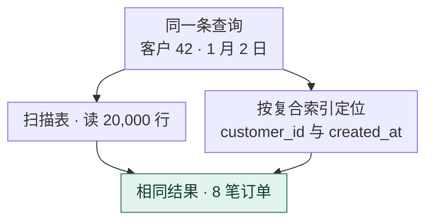

# 第 07 章 · 索引与性能学习概览

> 一条查询最终只返回 8 行，先查它为了得到这 8 行做了多少工作。

## 这一章学什么

- 用 `EXPLAIN` 认识访问类型、所选索引与估算行数。
- 用 `EXPLAIN ANALYZE` 看读取过程和实际行数。
- 理解复合索引的前导列，改写日期条件并考虑维护成本。

## 有什么用

查客户 42 在 1 月 2 日的订单。性能样本有 20,000 行。忽略二级索引时，MySQL 要扫描并筛选；复合索引按客户定位，再缩小到目标日期。两条路径在本课返回同一组订单。

遇到查询变慢时，用执行计划定位工作量，把日期边界和索引顺序配起来，再确认改写前后的结果相同。

## 从哪里开始

1. [用 EXPLAIN 观察索引](01_用EXPLAIN观察索引.md)，比较同一查询的扫描路径和索引路径。
2. [复合索引与查询改写](02_复合索引与查询改写.md)，核验日期范围、排序与额外查表成本。

**学完自检** 能在计划中指出所用索引、哪一层读了多少行，并区分估算行数与实际行数。

[全课程学习逻辑图](../学习逻辑图.md) · [教材首页](../README_怎么用.md)
