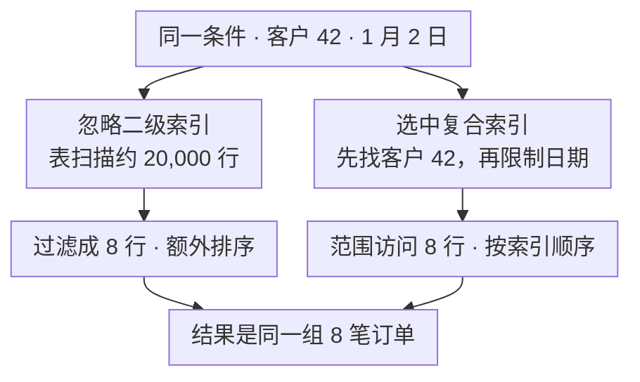

# 第 07 章 · 用 EXPLAIN 观察索引

> 同样查到 8 行，数据库可能读了 20,000 行，也可能只访问一个很窄的索引区间。

## 学习目标

- 让同一查询用两种访问路径，核对结果集相同。
- 分清 EXPLAIN 的估算与 EXPLAIN ANALYZE 的实际行数。

## 准备

缺表时运行[配套 SQL](00_安装配套表.sql)。表 `c7_orders` 有 20,000 行，客户号 1～200，每位各 100 笔。建表时已创建 `(customer_id, created_at)` 索引。造数据的语句仅用于准备样本。
```sql
USE learn;
SELECT COUNT(*) AS orders, COUNT(DISTINCT customer_id) AS customers FROM c7_orders;
```

## 一、固定问题和答案，再比较路径

需求是「客户 42 在 1 月 2 日的订单，按时间排」。用 `>=` 当日起点和 `<` 次日起点，日期有时分秒也不会漏掉。先记录答案。订单号是 1442、1642、1842、2042、2242、2442、2642、2842，共 8 行。

```sql
SELECT id, created_at, amount
FROM c7_orders
WHERE customer_id = 42
  AND created_at >= '2026-01-02'
  AND created_at <  '2026-01-03'
ORDER BY created_at;
```

演练对同一张表做两个计划。第一个显式忽略这个二级索引，以便看清扫描基线；第二个让优化器自己选。提示只用于这次对照。

```sql
EXPLAIN FORMAT=TRADITIONAL
SELECT id, created_at, amount
FROM c7_orders IGNORE INDEX (idx_c7_customer_time)
WHERE customer_id = 42
  AND created_at >= '2026-01-02'
  AND created_at <  '2026-01-03'
ORDER BY created_at;

EXPLAIN FORMAT=TRADITIONAL
SELECT id, created_at, amount
FROM c7_orders
WHERE customer_id = 42
  AND created_at >= '2026-01-02'
  AND created_at <  '2026-01-03'
ORDER BY created_at;
```

| 看哪一列 | 忽略索引的样本实测 | 优化器可选索引时 |
|---|---|---|
| `type` | `ALL`，扫描表 | `range`，按范围读 |
| `key` | `NULL` | `idx_c7_customer_time` |
| `rows` | 量级约两万 | 约 8 |
| `Extra` | 筛选，通常另做排序 | 能利用索引顺序，通常不用单独排序 |

`rows` 是估算。统计信息变化后，数字可以不同。`Using filesort` 表示引擎执行额外排序，名称本身不能证明写了磁盘。

## 二、实际执行时，每一层交出了多少行

```sql
EXPLAIN ANALYZE
SELECT id, created_at, amount
FROM c7_orders IGNORE INDEX (idx_c7_customer_time)
WHERE customer_id = 42
  AND created_at >= '2026-01-02'
  AND created_at <  '2026-01-03'
ORDER BY created_at;

EXPLAIN ANALYZE
SELECT id, created_at, amount
FROM c7_orders
WHERE customer_id = 42
  AND created_at >= '2026-01-02'
  AND created_at <  '2026-01-03'
ORDER BY created_at;
```

`EXPLAIN ANALYZE` 会执行这个读查询。看树上每层的 `actual … rows=… loops=…`。本机数据中，扫描路径从表读取 20,000 行，过滤后留下 8；索引路径的范围访问返回 8 行。时间受缓存和负载影响，本课验收访问路径与行数。



正式评价性能时先看结果口径、测试条件和读了多少数据。查询已有副作用的语句时，先了解所属引擎如何处理 `EXPLAIN ANALYZE`，本课只对 SELECT 使用。可查 [MySQL EXPLAIN 手册](https://dev.mysql.com/doc/refman/26.10/en/explain.html)。

## 小结

固定查询结果后，再用实际执行行数说明索引节省了什么。时间只作为同等条件下的补充观察。

## 动手练习

### 练习 1 · 下一天仍用同一个索引吗

查客户 42 在 1 月 3 日的记录，先数结果，再看计划。

<details>
<summary>展开参考答案</summary>

```sql
SELECT COUNT(*) AS orders FROM c7_orders
WHERE customer_id = 42 AND created_at >= '2026-01-03' AND created_at < '2026-01-04';
EXPLAIN FORMAT=TRADITIONAL
SELECT id, amount FROM c7_orders
WHERE customer_id = 42 AND created_at >= '2026-01-03' AND created_at < '2026-01-04';
```

应有 7 笔。计划可使用复合索引的客户等值与时间范围。

</details>

### 练习 2 · 估算与实际差异

为什么 EXPLAIN 扫描估算可能写成 20,349，而实际读了 20,000？

<details>
<summary>展开参考答案</summary>

优化器根据统计信息估算成本及行数，模型不是精确计数。EXPLAIN ANALYZE 记录本次运行的实际输出。

</details>

**下一篇** [复合索引与查询改写](02_复合索引与查询改写.md)
