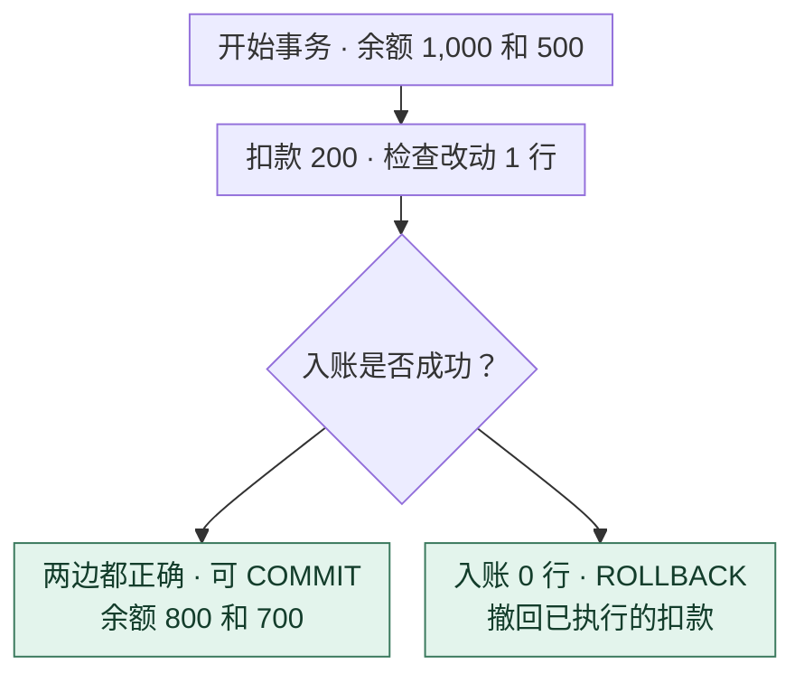

# 第 08 章 · 事务学习概览

> 转账扣了款却入不了账时，数据库应回到转账前。用两次写入和两个连接看清保障来自哪里。

## 这一章学什么

- 用 `START TRANSACTION`、`COMMIT` 和 `ROLLBACK` 管理相关操作。
- 用两条连接观察一致性读、提交、回滚和锁等待。
- 理解 ACID 的具体问题，以及超时或死锁后该重试哪一段业务。

## 有什么用

1 号有 1,000 元，2 号有 500 元。转 200 元以后，余额应变成 800 和 700，合计仍是 1,500。若收款账号不存在，更新 0 行也可能没有 SQL 报错，仍应撤回已经执行的扣款。

事务把「扣款与入账要么都成功，要么都不留下」交给显式边界。课堂成功路径也会回滚，方便你重新演练。后一课用 A、B 两个会话揭示为什么另一端有时仍读到旧值。

## 从哪里开始

1. [原子性与转账](01_原子性与转账.md)，让失败分支撤回整个业务动作。
2. [两个连接看隔离与锁](02_两个连接看隔离与锁.md)，核对连接 ID，验证快照与锁等待。

**学完自检** 能说明为什么更新 0 行也可能需要回滚，以及为什么提交后另一个仍开着的读事务可能看到旧值。

[全课程学习逻辑图](../学习逻辑图.md) · [教材首页](../README_怎么用.md)
