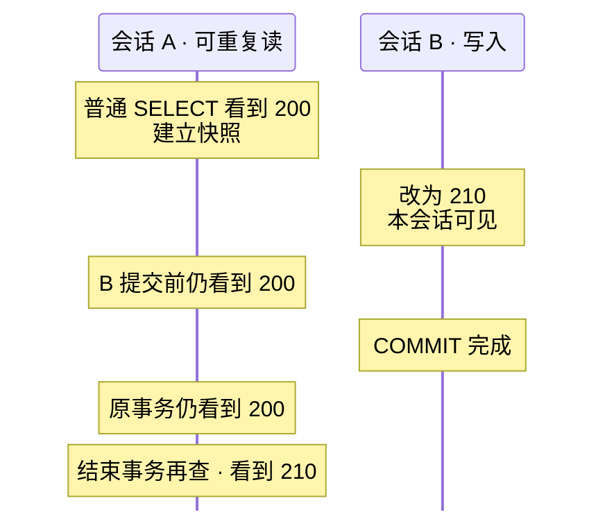

# 第 08 章 · 两个连接看隔离与锁

> 另一个人已经提交了新余额。你为什么还读到旧数？先看看两个查询是不是在同一笔事务里。

## 学习目标

- 在两个真实连接观察未提交值、已提交值与旧快照。
- 用 FOR UPDATE 制造可复现的锁等待，区分超时与死锁。

## 准备

使用[第 08 章配套表](00_安装配套表.sql)，初始 3 号账户余额为 200.00。在 HeidiSQL 开两个数据库会话，分别叫 A 和 B。在两边各执行下面一块，`CONNECTION_ID()` 必须不同。只多开一个 SQL 标签时，先核验编号再继续。演练使用自动提交为 1 的两个专用会话，然后用 START TRANSACTION 明确开始每笔事务。
```sql
USE learn;
SELECT CONNECTION_ID() AS connection_id, @@autocommit AS autocommit;
SELECT id, balance FROM c8_accounts WHERE id = 3;
```

## 一、一次普通读取到底从哪份数据看

下面按标注交替执行，每次只运行当前块。隔离级别设置只用于 A 的下一笔事务；做完全套会把 3 号恢复为 200.00。使用教学专用表，避免与其他正在做同一演练的人并行运行。

**A1**。设为可重复读并进行首次普通读取。

```sql
-- 会话 A
SET TRANSACTION ISOLATION LEVEL REPEATABLE READ;
START TRANSACTION;
SELECT balance FROM c8_accounts WHERE id = 3;
```

读到 200.00。保持 A 的事务开着。**B1** 开事务并更新余额，暂不提交。

```sql
-- 会话 B
START TRANSACTION;
UPDATE c8_accounts SET balance = 210.00 WHERE id = 3 AND balance = 200.00;
SELECT ROW_COUNT() AS changed;
SELECT balance FROM c8_accounts WHERE id = 3;
```

B 应显示 1 行被改，自己读到 210.00。若改动行数不为 1，回滚 B，再结束 A，检查样本。**A2** 再读，仍是 200.00。

```sql
-- 会话 A
SELECT balance FROM c8_accounts WHERE id = 3;
```

**B2** 提交，**A3** 在原事务中再读。这一步继续看到 200.00，直到结束 A 的事务再查，才显示 210.00。

```sql
-- 会话 B
COMMIT;
```

```sql
-- 会话 A
SELECT balance FROM c8_accounts WHERE id = 3;
COMMIT;
SELECT balance FROM c8_accounts WHERE id = 3;
```

**B3** 调回专用练习数据，看到 1 行改动后提交。这里已经结束了 A 的旧快照。

```sql
-- 会话 B
START TRANSACTION;
UPDATE c8_accounts SET balance = 200.00 WHERE id = 3 AND balance = 210.00;
SELECT ROW_COUNT() AS restored;
COMMIT;
```



`REPEATABLE READ` 的普通一致性读复用该事务已有的快照。重做完整一轮，把 A1 换成 `SET TRANSACTION ISOLATION LEVEL READ COMMITTED`，预测 B2 之前和之后的结果。提交之前仍读到 200，提交之后 A3 的第一次读取就变成 210。范围、锁定读和混合写操作还会有各自规则，本节只观察同一行的普通读取。

| 隔离级别 | 这个练习要点 |
|---|---|
| `READ UNCOMMITTED` | 普通读可能读到别人未提交的值，本课无需切换验证 |
| `READ COMMITTED` | 普通一致性读每次建立新快照 |
| `REPEATABLE READ` | 同一事务内的普通一致性读沿用该事务的快照 |
| `SERIALIZABLE` | InnoDB 在特定事务条件下会把普通读变成锁定读，可提高隔离并增加等待 |

## 二、锁定读会让冲突的写入等待

准备结束上节各自的事务。**A** 锁定主键 1。

```sql
-- 会话 A
START TRANSACTION;
SELECT id, balance FROM c8_accounts WHERE id = 1 FOR UPDATE;
```

**B** 先设置本会话较短的等待时间。保存原设置，实验结束一并恢复。

```sql
-- 会话 B
SET @before_wait = @@SESSION.innodb_lock_wait_timeout;
SET SESSION innodb_lock_wait_timeout = 2;
START TRANSACTION;
```

**B** 单独执行下面的写入。只要 A 还持锁，约两秒后收到 1205。

```sql
-- 会话 B
-- 预期错误 1205
UPDATE c8_accounts SET balance = balance + 1 WHERE id = 1;
```

现在各自在原连接结束实验。

```sql
-- 会话 B
ROLLBACK;
SET SESSION innodb_lock_wait_timeout = @before_wait;
```

```sql
-- 会话 A
ROLLBACK;
```

死锁和单向等待不同：A 锁住 1 又需要 2，B 锁住 2 又需要 1。启用死锁检测时，InnoDB 会让一方成为牺牲者，通常报 `1213`，把该笔事务回滚。业务可在确认适合重试后，重新执行完整事务，并限制次数；不要只重试最后的 SQL。固定多对象操作的加锁顺序、缩短事务时间，能减少这类冲突。另见 [MySQL InnoDB 隔离级别](https://dev.mysql.com/doc/refman/26.10/en/innodb-transaction-isolation-levels.html)。

## 小结

普通查询会受快照影响，锁定读会影响并发写入。定位问题时先核对连接 ID、事务开始和结束时刻。

## 动手练习

### 练习 1 · 读到新值说明什么

在 READ COMMITTED 实验里，A 第一次读到 200，第二次读到 210。B 是否一定在第二次读前完成了提交？

<details>
<summary>展开参考答案</summary>

在这套受控演练里是的。A 没写 3 号，且发生变化的唯一来源是 B；每次普通读使用当时已提交的数据。

</details>

### 练习 2 · 重试哪一段

A 的转账执行到一半收到死锁错误，下一步从扣款前还是从入账前重试？

<details>
<summary>展开参考答案</summary>

从完整事务入口重新开始，并先确认业务请求可安全重试。死锁牺牲事务可能已整体回滚。

</details>

**下一章** [第 09 章 · Python 操作数据库学习概览](../09_Python操作/00_学习概览.md)
