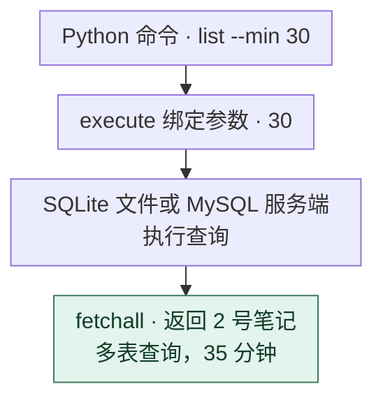

# 第 09 章 · Python 操作数据库学习概览

> 在 HeidiSQL 里核过的查询可以交给程序反复执行。让 Python 负责连接、传参、取结果和收尾。

## 这一章学什么

- 用连接和游标执行 SQL，并把结果取回为 Python 数据。
- 给 SQLite 使用 `?`，给 PyMySQL 使用 `%s`，把筛选值独立绑定。
- 区分写入后的提交、失败后的回滚与连接关闭。

## 有什么用

写一个按最小时长查询学习笔记的命令。传入 30 分钟时，样本中只显示「多表查询，35 分钟」。数据库返回后由 Python 遍历结果，参数也可以是带引号的标题。

数据库步骤可以变成可复跑的工具，再用批量插入第二条故意失败的例子，检查第一条是否一起回滚。

## 从哪里开始

1. [连接、游标与参数](01_连接游标与参数.md)，用脚本把 SQL 和数值参数分开传入。
2. [提交、回滚与资源关闭](02_提交回滚与资源关闭.md)，核对新连接能否读取已提交数据。

**学完自检** 能在代码里指出 SQL 模板、数据参数、提交、回滚和资源关闭各发生在哪里。

[全课程学习逻辑图](../学习逻辑图.md) · [教材首页](../README_怎么用.md)
