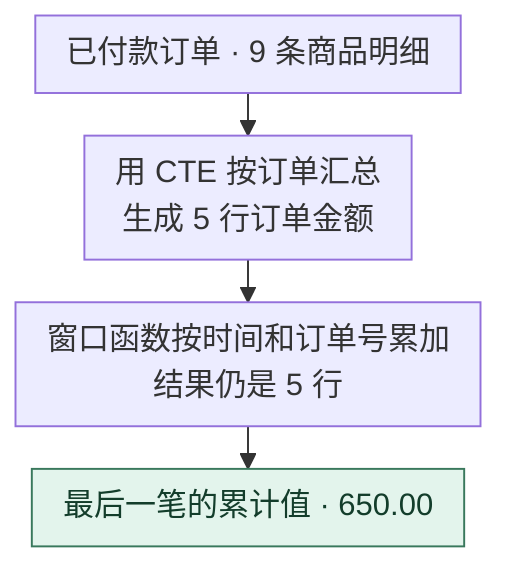

# 第 10 章 · 进阶特性学习概览

> 长报表先拆成能单独核对的步骤，再在需要时给每行加上排名或累计值。

## 这一章学什么

- 用 `WITH` 给一条 SQL 中的中间结果取名，说明每一步的一行是什么。
- 用视图保存可重复查询的定义，明确报表的口径。
- 用窗口函数计算排名或累计金额，处理并列与窗口范围。

## 有什么用

用第 05 章的电商数据做流水报表。付款后的一笔订单可能有多条明细，先累计成一笔订单一行。然后在每笔订单后加上累计收入，同时保留各自金额。

同样的拆法能做「每类前几名」和「某时刻累计多少」的报表。加排名前先讲清并列要不要保留，做累计前先定排序和窗口范围。

## 从哪里开始

1. [CTE 与视图](01_CTE与视图.md)，拆出可核对的统计步骤并保存复用口径。
2. [窗口函数与排名](02_窗口函数与排名.md)，比较并列排名、精确前 N 与逐行累计。

**学完自检** 给定 101 号订单的两条明细，能说明哪一步把它们合成一行，以及窗口函数为什么还保留那一行。

[全课程学习逻辑图](../学习逻辑图.md) · [教材首页](../README_怎么用.md)
