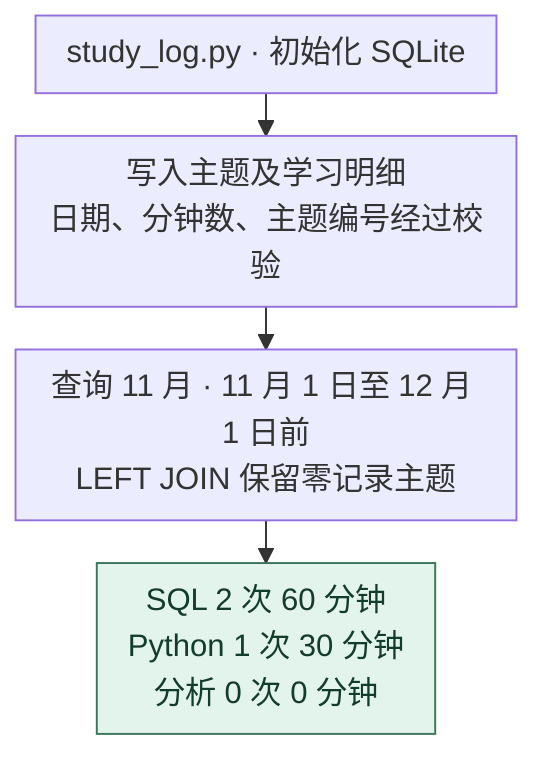

# 第 11 章 · 实战项目学习概览

> 把建表、参数绑定、事务和报表连成一个真正可运行的学习记录工具。

## 这一章学什么

- 用 SQLite 管理学习主题和明细，初始化并录入样本。
- 保存记录、归档主题，用外连接生成一份包含零记录主题的区间报表。
- 验证日期边界、非法输入、写入回滚和归档后的历史。

## 有什么用

你要统计 11 月学了什么。演示样本有 SQL、Python、分析三项。11 月 1 日纳入，12 月 1 日留给下期；分析没学也显示 0 次。由此可以检查命令结果是否符合需求。

从空文件跑通只是第一步。再试不存在的主题、时长为 0、归档后写入等输入，用独立查询检查失败没有改变已有记录。

## 从哪里开始

1. [学习记录项目](01_学习记录项目.md)，从空数据库跑通录入与报表。
2. [验收与扩展](02_验收与扩展.md)，复核成功、失败、日期和归档边界。

**学完自检** 能从空文件复现这张报表，再演示一次失败操作，证明下一次查询仍得到原有数据。

[全课程学习逻辑图](../学习逻辑图.md) · [教材首页](../README_怎么用.md)
