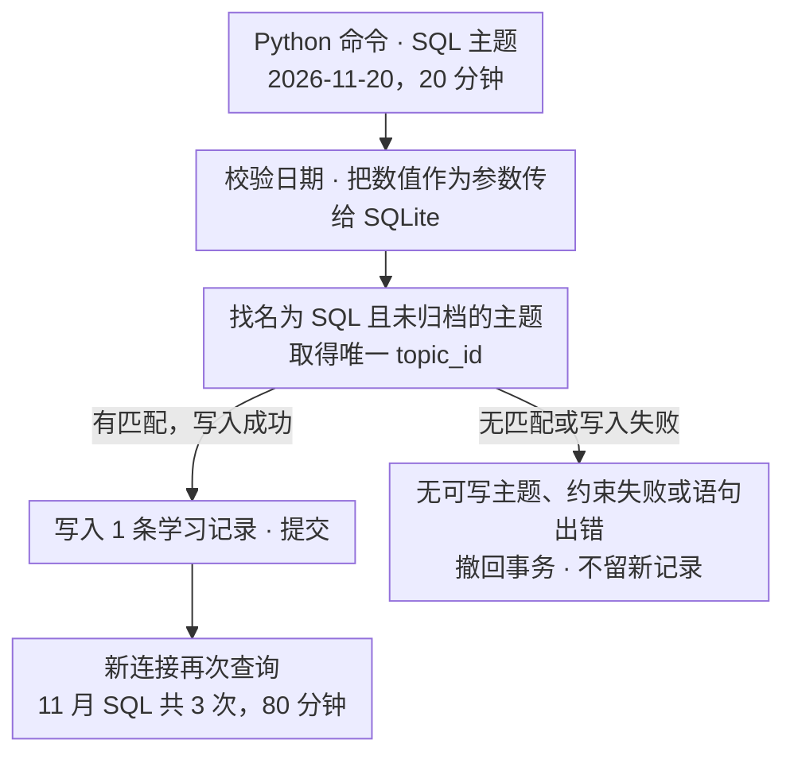

# 第 11 章 · 学习记录项目

> 做一个实际能用的小工具。你能记学习时长，也能查零次学习的主题，并证明报表没有漏算日期边界。

## 学习目标

- 从业务规则画出两张表和它们的一对多关系。
- 初始化 SQLite 文件，录入样本并核对按区间汇总结果。
- 读懂一次写操作从 Python 参数传入到持久化的流程。

## 准备

本章使用 SQLite，要求 Python 3.12+、SQLite 3.37+。需要本目录里的[应用脚本](study_log.py)与[建表 SQL](00_SQLite建表.sql)，两者保持放在同一目录。从本目录打开 PowerShell，本章创建独立的 `c11_study.sqlite3`。若已经有自己的练习文件，改用 `--db c11_new.sqlite3`，把该选项放在子命令前。

## 一、把需求翻译成可以验收的规则

| 需求 | 表或列 | 约束 |
|---|---|---|
| 有主题，例如 SQL，主题名不可重复 | `c11_topics.name` | `UNIQUE`，去掉两端空格后必填 |
| 一个主题可有多条学习记录 | `c11_sessions.topic_id` | 外键，主题必须存在 |
| 日期要能比较，时长是 1～600 的整数分钟 | `studied_on`、`minutes` | ISO 日期文本，类型和范围检查 |
| 归档后保留历史，拒绝写入新记录 | `c11_topics.archived` | 默认 0，命令写入时检查是活跃主题 |

对「一条明细为什么需要自己的编号」可回想第 05 章。一人可能同一天学习 SQL 两次。`(topic_id, studied_on)` 会把确实不同的两次学习挡住，故每条记录有独立 `id`。

## 二、跑通一个完整流程

```powershell
python .\study_log.py init
python .\study_log.py demo
python .\study_log.py report 2026-11-01 2026-12-01
```

`init` 建两张表及一个索引，可在同一演练文件重复执行；`demo` 只允许向没有主题的练习文件写样本。它写入 SQL、Python、分析三个主题和四条记录。统计结果应是：

```text
SQL | 2 次 | 60 分钟
Python | 1 次 | 30 分钟
分析 | 0 次 | 0 分钟
```

12 月 1 日的 45 分钟在右边界上，属于下一个区间，所以这次不计入。分析没有记录，依然保留一行。

## 三、读懂新增记录的路径

```powershell
python .\study_log.py session "SQL" 2026-11-20 20 --note "事务练习"
python .\study_log.py report 2026-11-01 2026-12-01
```

报告中的 SQL 变为 `3 次 | 80 分钟`，其余两行不变。



看脚本里的 `INSERT_SESSION_SQL`。它在同一条语句里挑出有效主题再插入，如果没有有效主题，写入 0 行，Python 就报告错误。`PRAGMA foreign_keys = ON` 在每个新连接、进入写事务前设置。归档旧主题用 `UPDATE`，查询历史记录仍可连接到它。

打开新命令前，先清楚自己正在改哪个文件。用户普通操作需要跨进程重新连接，报告结果因此能验证真实提交。

## 小结

按业务粒度建表与约束，参数化写值，用独立新连接核对提交后的报表。

## 动手练习

### 练习 1 · 预测下一期报告

执行 `report 2026-12-01 2027-01-01`，SQL 应有几次、几分钟？

<details>
<summary>展开参考答案</summary>

1 次、45 分钟。其他主题仍保留为零行匹配。写日期区间时，起点包含，终点不含。

</details>

### 练习 2 · 给 0 行留个位置

为什么没有记录的分析主题也要显示？

<details>
<summary>展开参考答案</summary>

报告以主题为一行。主题就是 LEFT JOIN 的左侧输入，缺记录时产生补空行，COUNT(s.id) 数不到任何记录，COALESCE 把空总时长变成 0。

</details>

**下一篇** [项目验收与扩展](02_验收与扩展.md)
