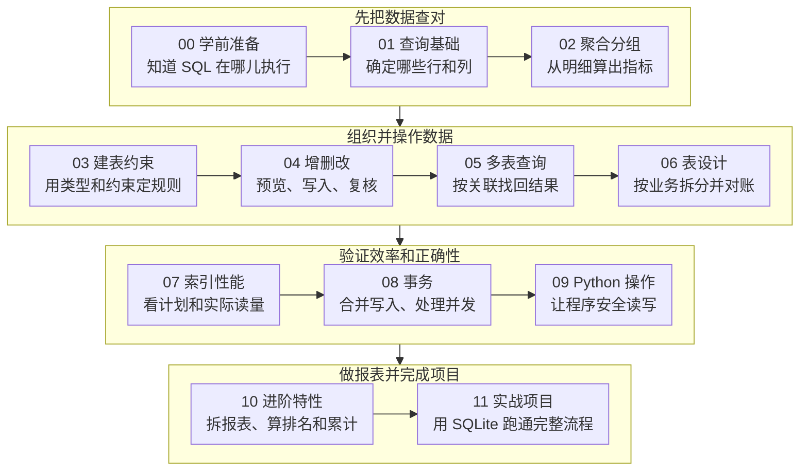

# 数据库课程学习逻辑图

> 从在 HeidiSQL 查到一条记录，走到写出一个可以提交、撤回并验收的 Python 数据库项目。

## 主线

箭头表示建议的学习顺序。每一组结束时都能独立完成一件事。已经学过某个主题，也可以从相应概览检验自己是否具备下一步所需的能力。

| 阶段 | 学完可以独立做什么 | 分章概览 |
|---|---|---|
| 查询与统计 | 给定需求，预测会返回几行、每行代表什么、数值口径是什么 | [00 学前准备](00_学前准备/00_学习概览.md) · [01 查询基础](01_查询基础/00_学习概览.md) · [02 聚合分组](02_聚合分组/00_学习概览.md) |
| 建表与关联 | 将数据拆成有清晰主外键的表，安全写入，再查成一份结果 | [03 建表约束](03_建表约束/00_学习概览.md) · [04 增删改](04_增删改/00_学习概览.md) · [05 多表查询](05_多表查询/00_学习概览.md) · [06 表设计](06_表设计/00_学习概览.md) |
| 性能与事务 | 查明慢在哪里，验证失败可撤回，并在程序里重现 | [07 索引与性能](07_索引与性能/00_学习概览.md) · [08 事务](08_事务/00_学习概览.md) · [09 Python 操作](09_Python操作/00_学习概览.md) |
| 报表与实战 | 拆解复杂指标，完成一个独立数据库文件和可验证的命令工具 | [10 进阶特性](10_进阶特性/00_学习概览.md) · [11 实战项目](11_实战项目/00_学习概览.md) |

## 前面的知识怎么用到后面

- **01 → 02 → 05**。先能预测单表筛选的行数，再理解计数单位。做多表查询时检查一对多是否让一笔订单变成多行。
- **03 → 05 → 06**。先知道外键能保障什么，再用关联键查结果。拆表迁移时把新旧数据按同样的键对账。
- **04 → 08 → 09**。先学先查后改，再把相关写入放入事务，最终由 Python 在合适的分支提交或回滚。
- **05 + 02 → 10**。先把报表做成需要的粒度，再用 CTE 给中间结果取名，用窗口函数在现有行上追加排名和累计。
- **03 + 05 + 08 + 09 → 11**。主题与记录遵循外键约束，左连接保留零记录主题，程序用参数化和事务写入。第 07、10 章的方法可以继续用来优化查询或扩展报表。

遇到问题先定位哪一层出错。连接和地址回看 00–01，行数或分母回看 01–02，重行或漏行回看 05，写入部分生效回看 04、08–09，最后回到项目验收复现。

[返回教材首页](README_怎么用.md)
